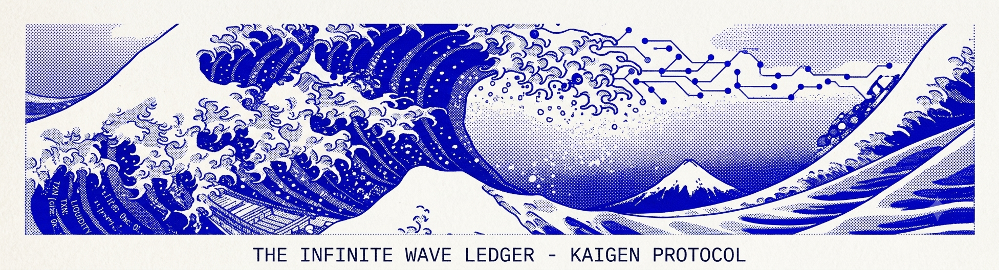
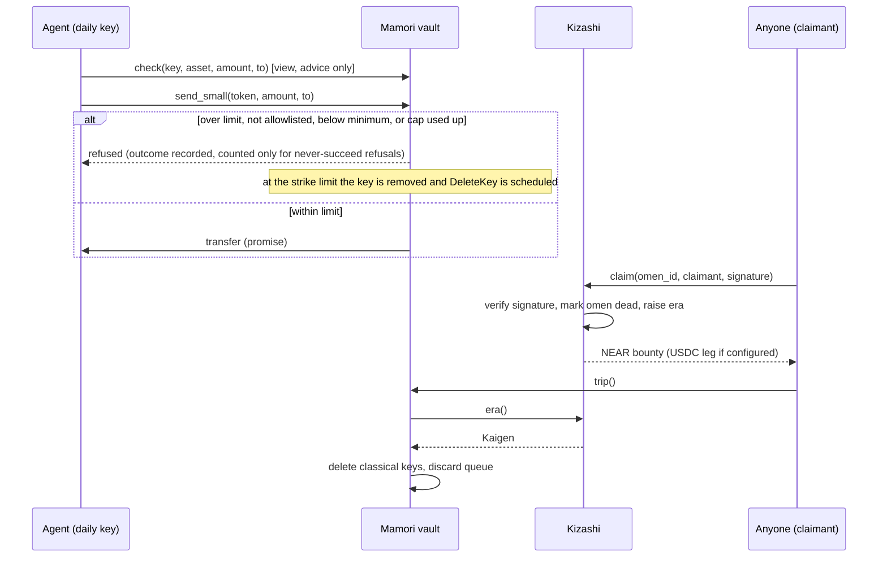

<p align="center"></p>

# KAIGEN: don't trust the agent, verify the cage

Give an AI agent a NEAR account and a prompt injection can talk it into emptying it. KAIGEN is a vault where the agent holds only a limited key, the most it can lose in any 24 hours is a written-down, property-tested number, and after three refused attacks the vault itself deletes the agent's key from the account. The admin key can be post-quantum (ML-DSA-65, testnet). You do not have to take our word for any of it: `cage-check` reads public chain data and tells you whether the cage holds.

In detail: KAIGEN is an on-chain vault for an AI agent's NEAR account: the agent holds only a function-call key, the contract caps what that key can move in any 24 hours at the cap plus the pending limit (11 times the cap at the default setting), and after three counted bad requests the contract schedules a DeleteKey for that key. [LOSS-BOUND.md section 1 and line 23; ATTEST-CHECK.md section 4; ATTACK-RESULTS.md section 11.1]

**Status: testnet only.** No outside audit. Nothing has run on mainnet. Sandbox numbers come from one local single-validator node, with an ed25519 admin key standing in for the ML-DSA-65 admin. [ROADMAP.md section 3; ATTACK-RESULTS.md section 0]

[Source Code](https://github.com/Andrew-Kevin-007/KAIGEN). Live app (testnet only): [kaigen-inky.vercel.app](https://kaigen-inky.vercel.app/). It can also run locally (see Getting Started). Design documents for v3 are in [docs/v3/](docs/v3/README.md).

## Try it (no keys, no chain, no wallet)

Needs Node 22.18 or later (24 recommended) and, for step 2, Rust via rustup (the repo pins 1.99.1 and fetches it). No keys, no funder file, no WSL, no `out/` folder. On Windows, run `set AWS_LC_SYS_PREBUILT_NASM=1` (PowerShell: `$env:AWS_LC_SYS_PREBUILT_NASM=1`) before step 2 if the build asks for NASM; Linux and macOS need nothing extra. Clone with LF line endings (default on Linux and macOS). Steps 1 and 2 download packages, crates and the pinned toolchain only. Step 3 reads a public testnet vault over RPC, read-only, and holds no key.

```sh
# 1. install (about 30 s). jobs/ imports scripts/, so both need their packages
(cd scripts && npm ci) && (cd jobs && npm ci)

# 2. the headline scene, offline: an injected agent is refused three times, then its key is burned (about 2.5 min cold)
cargo test -p mamori demo_story -- --nocapture
#   ...  [4] REFUSED  ... strike 3/3 | KEY BURNED
#   ...  [6] REFUSED  the burned key's next attempt: not a recorded daily key
#   ...  HELD: 0.1 NEAR moved, all 3 attacks refused, the key is gone
#   ...  test result: ok. 1 passed; 0 failed

# 3. check a live testnet vault, read-only, no keys (1.5 s)
node jobs/src/bin.mjs cage-check pv-45cbcb96.kaigen-funder-ee0d56.testnet --rpc https://rpc.testnet.fastnear.com \
  --admin ml-dsa-65-hash:BrXHPEEZqnGA3x39K381CKgNG3o1gH9i8x1pCEBMuCdo --code-hash AoxPd3zABfzDRoPsE14ReAzMrzq5o5rMFj8FZXn9zKoQ
#   ...  GREEN: all 15 conditions hold.      (exit code 0)

# 4. the rest of the suite
(cd jobs && node --test test/*.test.mjs)     # at least 373 tests, 372 pass, 1 skipped (needs built artifacts), about 13 s
(cd scripts && node --test *.test.mjs)       # at least 20 tests, 19 pass, 1 skipped
cargo test --workspace                       # kizashi at least 104, mamori at least 231, about 2.5 min cold
```

## Live on testnet

Point in time: re-run before relying on it. The explorer pages sit behind a browser check that automated tools cannot pass, so these links were not opened by the author's tooling.

| Account | What it is | Explorer |
| --- | --- | --- |
| `pv-45cbcb96.kaigen-funder-ee0d56.testnet` | Production-mode vault: production wasm, 24 h delay, ML-DSA-only admin, cage-check GREEN on 15 conditions | https://testnet.nearblocks.io/address/pv-45cbcb96.kaigen-funder-ee0d56.testnet |
| `vault.kaigen-funder-a00266.testnet` | Drill vault: drill build, 10 s delay, drill omens; used by the stretch run | https://testnet.nearblocks.io/address/vault.kaigen-funder-a00266.testnet |
| `kizashi.kaigen-funder-a00266.testnet` | Drill Kizashi: drill omens, no production omens | https://testnet.nearblocks.io/address/kizashi.kaigen-funder-a00266.testnet |

Cage-check for the production-mode vault is the step 3 command above. [TESTNET-REHEARSAL.md third run]

## Try it in the browser

Live testnet app: https://kaigen-inky.vercel.app/

- **[/xray](https://kaigen-inky.vercel.app/xray)**: paste any NEAR account and read, live and read-only, every access key, its limits, the code hash and the 15 cage conditions (GREEN, RED or UNKNOWN, the same rules as `cage-check`). It also works on accounts that are not KAIGEN vaults, where it says only what the key list proves. One click loads the production-mode vault, which reads GREEN. [docs/v3/XRAY.md](docs/v3/XRAY.md)
- **[/arena](https://kaigen-inky.vercel.app/arena)**: bring your own LLM and your own API key (OpenRouter or Anthropic; the key stays in your browser tab and goes only to the provider). Your model reads an invoice with a hidden instruction to pay an attacker, and you watch the vault rules refuse it, count strikes and burn the key. Choose a naive or a defended agent and one of three injection levels. **The vault side is a simulation of the contract's rules, not the chain, and the page says so.** [docs/v3/ARENA.md](docs/v3/ARENA.md)
- **Vault page**: shows the proven worst-case loss for an agent, per token, with the formula and the inputs it used.

## What is proven, where

| Claim | Where to check | Result |
| --- | --- | --- |
| Headline scene, offline | `cargo test -p mamori demo_story -- --nocapture`; [contracts/mamori/src/tests/demo_story.rs](contracts/mamori/src/tests/demo_story.rs) | Real contract code in the NEAR unit VM. The DeleteKey receipt is scheduled, not executed (executed on chain below). |
| Nine scripted attacks, measured | [docs/v3/ATTACK-RESULTS.md](docs/v3/ATTACK-RESULTS.md) | Sandbox only. Attack 2 loses exactly one cap (1 NEAR) with zero strikes. Attack 1 moves 0 NEAR to the attacker. |
| Loss bound | [docs/v3/LOSS-BOUND.md](docs/v3/LOSS-BOUND.md) sections 4 and 5 | Property tests check the bound after every step; mutation checks show each condition is needed. |
| Testnet rehearsal and zero-key Kizashi | [docs/v3/TESTNET-REHEARSAL.md](docs/v3/TESTNET-REHEARSAL.md), 2026-11-04 runs | Ten defence steps held on chain; the burned key was removed and then refused. |
| Stretch items on a real chain | Same file, "Third run" section | Eight steps passed on a drill vault with a 10 s delay. |
| cage-check red and green with a planted key | Same file, third run; [ATTACK-RESULTS.md](docs/v3/ATTACK-RESULTS.md) attack 8 | A planted ed25519 full-access key turns cage-check RED (ARCH-2.8-1); removing it returns GREEN. |
| 90-second demo script | [docs/v3/DEMO-SCRIPT.md](docs/v3/DEMO-SCRIPT.md) | Shot list, commands, numbers to read out, and the caveat it must say aloud. |
| Prompt-injected agent against the vault, on a real chain | `node jobs/src/bin.mjs inject-demo --model mock`; [docs/v3/INJECT-DEMO.md](docs/v3/INJECT-DEMO.md); [recorded run](docs/v3/evidence/INJECT-DEMO-mock-2026-11-08.md) | The recorded on-chain run used a scripted MOCK agent, labelled on every line, not a language model. The honest payment went through, three injected payments were refused, the third strike burned the key, and the node refused the next attempt. The `anthropic` and `openrouter` modes are tested with stubs only in this repository. |
| X-ray and the worst-case number | [docs/v3/XRAY.md](docs/v3/XRAY.md); `/xray` on the live app | Unit-tested; read live against the production-mode vault (GREEN, 15 conditions) and the drill vault (RED on ATTEST-2 only, by design). |
| Arena | [docs/v3/ARENA.md](docs/v3/ARENA.md) | The simulation reproduces the numbers of the offline demo test. Provider calls are tested with stubs; real runs happen in each visitor's own browser and are not recorded here. |

## What is NOT proven

- No outside audit. [ROADMAP.md section 3]
- The arena's vault is a simulation of the rules in the browser, not a chain. A model that resists the injection shows that the agent held, not that the vault was needed, and a model that falls under the naive setup says nothing about agents told to distrust invoice text. [ARENA.md]
- No language-model run of `inject-demo` is recorded in this repository; the on-chain recording used the labelled MOCK agent. [INJECT-DEMO.md]
- Testnet only. Mainnet availability of the global-contract mechanism is unconfirmed. [GLOBAL-CONTRACT.md section 7]
- The real Mamori global-contract publish was not run; the mechanism was shown with a 1,024-byte module. [GLOBAL-CONTRACT.md sections 6a and 7]
- Sandbox attacks use an ed25519 admin stand-in. The ML-DSA admin flow is not covered by these numbers. [ATTACK-RESULTS.md sections 0 and 13]
- The live rehearsal used drill builds (10 s delay, drill omens). The production-mode vault had no withdrawal, strike or fire test. [TESTNET-REHEARSAL.md third run]
- Peer projects were not run, so this README makes no comparison with them. [README.md, Limits of these numbers]
- The Kizashi refund-ordering gap is documented and unfixed: a refund that reaches the contract before its callback, with a claim in between, can book NEAR owed twice. [KIZASHI-REFUND-ORDER.md]

## Track

**Track:** AI Security & Defense. The entry covers function-call access keys, an attack demo with a log, a prompt-injection arena where visitors bring their own LLM (a labelled simulation), a live X-ray that reads any account's keys, a read-only counterparty check (`node jobs/src/bin.mjs counterparty <vault> <to>`: account age, contract and recent code change, past payments and a blocklist with evidence; a signal it cannot read counts as a warning, never as a pass; advisory only [docs/v3/COUNTERPARTY.md](docs/v3/COUNTERPARTY.md)), a recipient allowlist enforced by the contract (off by default), and the vault as the last line. The Kizashi omen bounty is an optional extra, not the headline. [LOSS-BOUND.md section 1; THREAT-MODEL.md section 6]

## Reference

---

## The Problem in one line

A NEAR account keeps accepting a key after that key is broken or stolen, and an AI agent holding a key can be talked into spending it, until someone notices and acts by hand.

| Failure mode | Why it survives today | What KAIGEN does |
| --- | --- | --- |
| A classical curve (ed25519, secp256k1) is broken | Classical keys stay on the account until someone deletes them. This is a general NEAR premise, not checked against the repository. | The ML-DSA-65 admin key deletes classical keys at lockdown. An omen claim, when someone discloses a break, raises the era, and `trip` then deletes the recorded classical keys. [ARCHITECTURE.md section 1] |
| An agent's hot key is prompt-injected or hijacked | The allowance on a function-call key is a gas budget, not a value cap | Per-token 24 h cap, allowlist (off by default), a queue with a delay for larger sends, and a strike count that burns the key. [LOSS-BOUND.md section 3, E1 to E9] |
| The owner has to watch every vault at once | Nobody online means no response | `trip` reads the era from Kizashi. Anyone can call it. [ATTEST-CHECK.md section 5] |

---

## Plain NEAR account and KAIGEN

The left column is the design premise. It was not measured. The right column lists what the v3 code and the sandbox showed.

| Situation | Plain NEAR account (premise) | With KAIGEN (v3, measured or tested) |
| --- | --- | --- |
| A classical key is broken | The key keeps working until a person deletes it | Lockdown at Kaigen deletes the recorded classical daily and intents keys, and repeat `trip` calls finish the job. Not measured end to end in v3. [ATTEST-CHECK.md section 5; ARCHITECTURE.md section 2.1] |
| An agent is prompt-injected | The key sends whatever it is asked, subject to its gas allowance | Over-cap sends, sends to unlisted payees (when the allowlist is on) and dust are refused. Three counted refusals burn the key. Attacks 1 and 7 PASS. [ATTACK-RESULTS.md attacks 1 and 7] |
| A large send is hijacked | It leaves at once | Sends above the direct-send limit wait in a queue for at least 24 h. The admin can cancel during the wait. Attacks 5 and 6 PASS. [ATTACK-RESULTS.md attacks 5 and 6] |
| Admin key | Often a classical full-access key (general premise, not checked against the repository) | ML-DSA-65 full-access key in the design. The sandbox admin was ed25519. [ATTACK-RESULTS.md section 0] |
| Who has to act | A person, after the fact | The contract refuses, counts and burns on its own rules. A person still has to cancel or re-key. [ARCHITECTURE.md section 4] |

---

## What the guard is, and what it is not

| Question | Answer |
| --- | --- |
| Why not just rotate to ML-DSA keys? | Rotation is the long-term step, and the v3 admin key is ML-DSA-65. Rotation does not cap hot keys. An ML-DSA key held by an agent can still be hijacked, so the cap and the burn are still needed. [THREAT-MODEL.md section 4; NOVELTY-CLAIMS.md section 3] |
| What is an omen? | A public key on ed25519 or secp256k1. Whoever breaks it can sign a claim. The contract verifies the signature, marks the omen dead and raises the era. It is a circuit breaker for a break someone discloses. It is not an early warning. [THREAT-MODEL.md section 6] |
| What does an omen not do? | It does not catch a silent attacker who never publishes a break. It does not catch a state actor who keeps a break private. It is not a canary: nothing says it breaks before the keys beside it. It does not say who broke the curve or how widely. [THREAT-MODEL.md sections 4 and 6] |
| What stops a hijacked hot key? | Per token, account-wide (not per key): a 24 h cap on direct sends, an allowlist (off by default), a queue with a delay for larger sends, and a strike count that burns the key. [LOSS-BOUND.md section 1] |
| What does a calibrated attacker do? | It reads `check` for its headroom and sends exactly the cap, with zero strikes. The loss is one cap per token per window. The counter does not stop this. [ATTACK-RESULTS.md attack 2; ATTEST-CHECK.md section 3.3] |
| Is a refusal a failure? | Not for `send_small`. A refusal returns a recorded outcome and nothing moves. It counts as a strike only when it can never succeed for an honest key. The key burns at the strike limit (default 3 inside 24 h, ceiling 10). `request_withdraw` refusals panic and are not counted. [ATTEST-CHECK.md section 4; ROADMAP.md Q-ABI] |
| Does a counted refusal ever hit an honest key? | Yes. A false burn was measured in a scripted honest trace. Its queued requests were cancelled and the key's request budget stayed spent for 24 h. The admin re-added the key. [ATTACK-RESULTS.md section 11.3] |

---

## Track and NEAR tech used

Track: **`security`** (AI Security & Defense), fallback **`open`** (Open Innovation). The organiser's track list is not in this repository.

| NEAR feature | Used for | State |
| --- | --- | --- |
| Function-call access keys with allowance | Daily keys can call only `send_small` and `request_withdraw` on the vault (`add_daily_key`). [LOSS-BOUND.md E6] | Tested on the sandbox (attacks 1 to 9). On testnet, 2026-11-04: the agent's key was refused and burned after three refused attacks, and a retry with it failed as nonexistent [TESTNET-REHEARSAL.md, first run]. |
| Full-access keys, AddKey and DeleteKey | Admin key rotation, and deleting keys on burn and at lockdown | Sandbox tested with an ed25519 admin. A burned key is removed from the account in the block after the burn decision. [[V3-M1-PROGRESS.md](docs/v3/evidence/V3-M1-PROGRESS.md); ATTACK-RESULTS.md section 11.1] |
| ML-DSA-65 full-access keys | Post-quantum admin key | Proven on testnet protocol 88 only. Mainnet protocol 86 has not run it (gate G1). [ROADMAP.md section 3] |
| Signature verification in the contract | Omen claims: ed25519 and secp256k1 (Kizashi) | Unit-tested in v3. The v2 drill records `fire-tests/0001.json` to `0004.json` report every step ok; the transactions are not re-checked here. |
| `attest()` and `check()` views | Posture and pre-flight | Implemented and unit-tested. `attest()` read by cage-check on the sandbox. [ATTEST-CHECK.md; [V3-W2-CAGE-PROGRESS.md](docs/v3/evidence/V3-W2-CAGE-PROGRESS.md)] |
| `intents.near` key registration | Lockdown removes recorded keys on `intents.near` | Code path present. Method names unconfirmed (gate G4). Not run on chain. [ROADMAP.md section 3] |
| 1Click (NEAR Intents) top-up | Top-up route in `app/` | UI and routes present. None of the six fire-test records has a USDC step; whether the USDC leg ever ran on a chain is not checked here. |

---

## How It Works

1. A vault is an account. Its full-access key is the admin key. Classical full-access keys must not be on the account. cage-check reports a red row if one is. [THREAT-MODEL.md section 1; ARCHITECTURE.md section 2.8]
2. Each hot key (human or agent) is a function-call key with an allowance (default 0.25 NEAR, a gas budget outside the cap). It can call only `send_small` and `request_withdraw`. [LOSS-BOUND.md A3; ARCHITECTURE.md section 2.3]
3. `send_small` decides in this order: key, era, amount, allowlist, token limit, minimum send, 24 h window. `check` runs the same function and reports what `send_small` would do. [ATTEST-CHECK.md sections 3 and 4]
4. A larger send goes to a queue. It is locked for at least 24 h and expires 24 h after it unlocks. The admin can cancel it during the lock. Queued value is capped at the pending limit per token. [LOSS-BOUND.md sections 1 and 2.2; [V3-MAMORI-PROGRESS.md](docs/v3/evidence/V3-MAMORI-PROGRESS.md) step 1]
5. A counted refusal is a strike against the calling key. At the limit, the vault removes the key from its records, cancels that key's queued requests, and schedules a DeleteKey. The key is refused from the next call and deleted from the account a block later. [ATTACK-RESULTS.md section 11.1]
6. An omen is a public key on a curve. Whoever breaks it signs a claim. Kizashi verifies the signature, marks the omen dead and raises the era. [THREAT-MODEL.md section 6; [V3-KIZASHI-PROGRESS.md](docs/v3/evidence/V3-KIZASHI-PROGRESS.md)]
7. Anyone can call `trip` on a vault. At `Warning` the vault pauses `send_small` and `request_withdraw`. Queued requests stay in the queue, and the admin can cancel them. At `Kaigen` the vault deletes its recorded classical daily and intents keys, and discards its queue. Repeat `trip` until both lists are empty. [ATTEST-CHECK.md section 5; LOSS-BOUND.md section 2.5]
8. `cage-check` reads the account's keys from RPC, reads `attest()`, and reports GREEN, RED or UNKNOWN. It is a point-in-time check. [ATTEST-CHECK.md section 2.3; [V3-W2-CAGE-PROGRESS.md](docs/v3/evidence/V3-W2-CAGE-PROGRESS.md)]

---

## Architecture

### System overview

```
                 +-------------------------------------------+
                 |                  NEAR                     |
                 |                                           |
  omen claim     |   +-------------+   era()    +----------+ |
  (anyone) ----->|   |   Kizashi   |<-----------|  Mamori  | |  vault = account
                 |   | omens, era, |            |  (per    | |  + ML-DSA admin key
                 |   |   bounty    |            |  vault)  | |  + daily keys
                 |   +-------------+            +----+-----+ |  + intents keys
                 |                                   |       |
                 |                       send_small / request_withdraw
                 |                                   |       |
  agent / human  |                                   v       |
  (daily key) -------------------------------------> transfer |
                 |                                           |
                 +-------------------------------------------+
  jobs/ (Node): keeper (trip), watchers, verify, cage-check, testnet rehearsal, mainnet tooling (dry-run)
  app/ (Next.js): era page, vault lookup, /migrate (key in browser), /bounty (1Click top-up)
  tests-integration/ (Rust, near-workspaces): burned-key deletion, cage-check on a sandbox, nine attacks
```

### Lifecycle

| Phase | What happens | Where it is enforced |
| --- | --- | --- |
| Init | Kizashi takes up to 8 omens. Mamori takes its daily limit and a delay of at least 24 h (production build). | `Kizashi::new`, `Mamori::init`; `min_delay_secs` in `attest()` [ATTEST-CHECK.md section 2.1] |
| Operate | Daily keys send within the 24 h cap. Larger sends queue. | `send_small`, `request_withdraw`, `execute`, `check` |
| Strike | Counted refusals count against the key. The key burns at the limit. | `judge_send` decides, `refuse` records [[V3-W2-EDITH-PROGRESS.md](docs/v3/evidence/V3-W2-EDITH-PROGRESS.md) M5a] |
| Warn | Era reaches `Warning`. `send_small` and `request_withdraw` pause. Queued requests stay frozen and cancellable. | `trip`, `on_era` |
| Kaigen | Era reaches `Kaigen`. Recorded classical daily and intents keys are deleted. The queue is discarded. Repeat `trip` until empty. | `trip`, `lock_down`, event `lockdown_partial` |
| Verify | cage-check and `attest()` report state. | `jobs/src/cage.mjs` |
| Lock (not done) | Kizashi's own access keys deleted, so it has no admin. | `mainnet lock` (`jobs/src/mainnet.mjs`), gated. Not run. |

---

## Sequence diagram



---

## Interfaces (v3)

| Method | Caller | Notes |
| --- | --- | --- |
| `send_small(token, amount, to)` | Daily key | Returns `SendOutcome`. Refusals are recorded outcomes. Zero amount and a non-daily key are panics. [ATTEST-CHECK.md section 4] |
| `request_withdraw(token, amount, to)` | Daily key | Returns the request id (U64, unchanged). Refusals panic and are not counted. Stores `expires_at`. [ROADMAP.md Q-ABI; [V3-MAMORI-PROGRESS.md](docs/v3/evidence/V3-MAMORI-PROGRESS.md) step 1] |
| `execute(id)` | Anyone | After the unlock time, before expiry, with the era calm. Refuses an expired request. [LOSS-BOUND.md E5; [V3-MAMORI-PROGRESS.md](docs/v3/evidence/V3-MAMORI-PROGRESS.md) step 1] |
| `cancel(id)` | Admin | Cancels one request. |
| `cancel_all()` | Admin | New in v3. Returns the count. [[V3-MAMORI-PROGRESS.md](docs/v3/evidence/V3-MAMORI-PROGRESS.md) step 2] |
| `purge_expired()` | Anyone | New in v3. Removes expired requests. Returns the count. [[V3-MAMORI-PROGRESS.md](docs/v3/evidence/V3-MAMORI-PROGRESS.md) step 2] |
| `check(key, asset, amount, to)` | View | New in v3. Advice only. Can be stale. [ATTEST-CHECK.md section 3] |
| `attest()` | View | New in v3. The state the contract records about itself. It does not return a code hash or a key list. [ATTEST-CHECK.md sections 2.1 and 2.2] |
| `strikes_of(key)` | View | Strikes in the current 24 h window. |
| `add_daily_key(key, allowance)` | Admin | Refuses a key that is revoked but not yet deleted from the account. [[V3-W2-EDITH-PROGRESS.md](docs/v3/evidence/V3-W2-EDITH-PROGRESS.md) M4a] |
| `remove_daily_key(key)` | Admin | Removes a key and schedules DeleteKey. |
| `register_intents_key(key)` | Admin | Records a key on `intents.near`. Such a key signs there with no Mamori cap. [ARCHITECTURE.md section 2.6] |
| `set_token_limit`, `set_pending_limit`, `set_min_send`, `allow_recipient`, `set_max_strikes`, `enforce_allowlist` | Admin | `set_max_strikes` accepts 1 to 10. [contracts/mamori/src/lib.rs] |
| `trip()` | Anyone | Reads the era from Kizashi and applies it. |
| `set_policy_account(account or null)` | Admin | Built (stretch). Names the one account whose `propose_*` calls are accepted. Clearing it drops every waiting proposal. [STRETCH-DESIGN.md section 1] |
| `propose_add_daily_key`, `propose_set_token_limit`, `propose_set_pending_limit`, `propose_allow_recipient` | Policy account | Built. Each records a proposal and returns its id. Nothing changes until `apply`. [STRETCH-DESIGN.md section 1] |
| `apply(id)` | Anyone | Built. Runs a proposal after `delay_secs` and before it lapses. [STRETCH-DESIGN.md sections 1 and 2, D6] |
| `cancel_proposal(id)` | Admin | Built. Throws one proposal away, before or after its delay. [STRETCH-DESIGN.md section 1] |
| `set_safe_account(account)`, `cancel_safe_account_change()` | Admin | Built. The change takes effect only after `delay_secs`, and can be cancelled until then. [STRETCH-DESIGN.md D9] |
| `add_watcher(account)`, `remove_watcher(account)`, `set_emergency(secs)` | Admin | Built. Up to 4 watchers. An emergency window of at most 7 days, in which watchers may sweep (0 closes it). [STRETCH-DESIGN.md section 1, D13] |
| `sweep_to_safe(id)` | Admin, or a watcher inside an emergency window | Built. No destination argument: the request's own token and amount go to the safe account in force. Refused for an expired request and while no safe account is set. A failed transfer is not put back. [STRETCH-DESIGN.md D10 to D12] |

Admin methods require `predecessor == current account`. A daily key cannot reach them, because the runtime restricts a function-call key to two methods. [ARCHITECTURE.md section 2.2]

**Stretch bound (built; unit and property tested; the sweep, policy and watcher paths and a NEP-141 sweep ran on a testnet drill vault, see Limits of these numbers).** The policy account and the watchers are accounts identified by predecessor, not keys of the vault (STRETCH-DESIGN.md D1). With C and P unchanged: loss stays at most C + P when the delay is at least 24 h; executes plus sweeps are at most 2P per window; everything that leaves the vault is at most C + 2P; sweeps go only to the admin-set safe account. 230 default and 226 drill Mamori tests pass. [LOSS-BOUND.md sections 9.2 and 9.4]

---

## Reason codes

The code is the stable name. The text is what `SendOutcome.refused` and the panics say. The text is unchanged from v2. `counted` is whether the refusal is a strike. [ATTEST-CHECK.md section 4]

| Code | Verdict | Counted | Text |
| --- | --- | --- | --- |
| `ok` | allow | no | `ok` (only in `check`) |
| `not_allowlisted` | refuse | yes | `recipient is not on the allowlist` |
| `over_cap_total` | refuse | yes | `over the 24 h limit` (amount above the whole 24 h cap) |
| `cap_exhausted` | refuse | no | `over the 24 h limit` (cap used up by earlier spend, possibly by another key) |
| `no_limit` | refuse | no | `no 24 h limit is set for this token` |
| `below_min_send` | refuse | no | `below the minimum send` |
| `not_a_daily_key` | reject | no | `not a recorded daily key` |
| `era_not_calm` | reject | no | `paused: era is not calm` |
| `zero_amount` | reject | no | `amount must be > 0` |
| `transfer_failed` | (none) | no | `the transfer failed and was refunded to the daily limit` (an outcome from the callback, not from `check`) |

Two codes share one text. Read the code, not the text, to tell them apart.

---

## Protocols and Standards

| Standard or protocol | Where | Notes |
| --- | --- | --- |
| NEAR access keys (function-call and full-access) | `mamori`, `chain.mjs` | Daily keys are function-call keys with allowance |
| ed25519 (RFC 8032) | `kizashi`, `scripts/omens.mjs` | Omen and claim verification |
| secp256k1 (ECDSA, low-s) | `kizashi`, `scripts/claim.mjs` | Omen and claim verification. |
| ML-DSA-65 (FIPS 204) | Admin key | Testnet protocol 88 proof only. The locked near-sdk 5.30 has an `MLDSA65` curve type and an ML-DSA verify host function. What the host returns for an ML-DSA signer is unverified. [[V3-W2-EDITH-PROGRESS.md](docs/v3/evidence/V3-W2-EDITH-PROGRESS.md)] |
| RFC 9380 hash-to-curve | `scripts/omens.mjs` | Omen keys derived from public seeds. |
| sha256 | `kizashi` | Claim digests. |
| NEAR Intents (`intents.near`) | `mamori` | Key removal path present. Not run on chain. |
| 1Click API | `app/app/api/topup/*` | Top-up quote and status routes. Not run on chain. |

---

## Contract addresses

| Contract | Network | Account | Where it is recorded |
| --- | --- | --- | --- |
| Kizashi (v2 drill twin) | NEAR testnet | `kizashi.kaigen-g1-0170217f.testnet` | `fire-tests/0001.json` to `0004.json` (v2). The account names appear there; whether the account still holds v2 code is not checked here. |
| Mamori vault (v2 drill) | NEAR testnet | `vault.kaigen-g1-0170217f.testnet` | `fire-tests/0001.json` to `0004.json` (v2). The account names appear there; whether the account still holds v2 code is not checked here. |
| Mamori v3 (drill and production-mode) | NEAR testnet | `pv-45cbcb96.kaigen-funder-ee0d56.testnet` (production-mode, 24 h delay); other drill vaults are in the gitignored testnet folder | v3 vaults must be deployed fresh, with no in-place upgrade [TESTNET-REHEARSAL.md, third run; CHANGES-V2-TO-V3.md section 1] |
| Kizashi | NEAR mainnet | none deployed | `deployments.json` is not committed. `deployments.example.json` is the shape. |

To create your own testnet accounts, run `node jobs/src/bin.mjs testnet`. It makes throwaway sub-accounts of one funded testnet account and prints their addresses. Nothing it creates is committed.

---

## Fairness and Integrity Safeguards

| Rule | Enforced on-chain | Function | Limit and default |
| --- | --- | --- | --- |
| Direct sends are capped in 24 h, per token, account-wide | Yes | `send_small`, `check` | Cap per token (`set_token_limit`). NEAR cap is `daily_limit`. A token with no admin-set cap cannot be sent. [LOSS-BOUND.md C_T, E1, E2] |
| Larger sends wait out a delay | Yes | `request_withdraw`, `execute` | At least 24 h in a production build. `init` refuses a shorter delay (E4). A `drill` build accepts any delay. [LOSS-BOUND.md E4] |
| Queued requests expire | Yes | `execute`, `purge_expired` | 24 h after the unlock time. [[V3-MAMORI-PROGRESS.md](docs/v3/evidence/V3-MAMORI-PROGRESS.md) step 1] |
| Queued value is capped per token | Yes | `request_withdraw`, queue room check | Pending limit P. Default 10 times the cap. Zero for a token with no cap unless the admin sets one. [LOSS-BOUND.md section 1] |
| Requests per 24 h are capped | Yes | `request_withdraw` | Budget of P per token per rolling 24 h. Executing or cancelling does not return it. [ATTACK-RESULTS.md attack 4b] |
| Per-key shares | Yes | `request_withdraw`, queue room check | With n recorded keys: `MAX_QUEUE / n` requests, `P / n` queued value, `P / n` budget per key. Account-wide limits still apply. [LOSS-BOUND.md section 1] |
| Only allowlisted recipients (when enforced) | Yes, when enforced | `send_small`, `allow_recipient` | Off by default. Up to 32 entries (`MAX_ALLOWED`). `request_withdraw` and `execute` can pay any payee. [LOSS-BOUND.md A10] |
| Refused keys are burned | Yes | `refuse` | 3 counted refusals in 24 h by default. Admin sets 1 to 10. [ARCHITECTURE.md section 2.1] |
| Only never-succeed refusals count | Yes | `judge_send` | Counted: `not_allowlisted`, `over_cap_total`. Uncounted: `cap_exhausted` and the rest. [ATTEST-CHECK.md section 4] |
| Re-adding a burned key | Yes | `add_daily_key` | Refused while the DeleteKey is unconfirmed. Re-adding after confirmation is allowed (admin only). [ATTACK-RESULTS.md section 11.3] |
| Dust and no-limit tokens do not burn a key | Yes | `send_small` | Minimum send 0.001 NEAR by default. [ATTACK-RESULTS.md section 0] |
| Lockdown at Kaigen | Yes | `trip`, `lock_down` | Deletes recorded daily and intents keys. Repeat `trip` until empty. [ATTEST-CHECK.md section 5] |
| Warning pauses sends and new withdrawal requests | Yes | `trip`, `on_era` | Era `Warning` |
| Omen keys cannot be reused | Yes | `Kizashi::new`, `claim` | |
| Drill reset is not in production | Yes | `reset` (drill feature only) | Refuses accounts that are not `.testnet`. |

---

## Measured results (v3, sandbox)

Sandbox: one validator, nearcore 2.14.0, protocol 88, 128 ms blocks, ed25519 admin, WSL. Vault configuration: cap 1 NEAR per 24 h, delay 86,400 s, 3 strikes (attack 1c uses 10), pending limit 10 NEAR, minimum send 0.001 NEAR. [ATTACK-RESULTS.md sections 0 and 13]

"PASS" means the attack's own asserted conditions held. It does not mean the contract is secure. [ATTACK-RESULTS.md section 14]

| # | Attack | Result | Headline numbers |
| --- | --- | --- | --- |
| 1 | Clumsy agent: over-cap or unlisted sends until burn | PASS (1a, 1b, 1c) | Loss 0 NEAR in all three. Key off the account 1 block after the burn decision. First attempt to deletion: 11 blocks (N=3), 46 blocks (N=10). [section 2] |
| 2 | Calibrated attacker: sends exactly the cap, reads `check` | PASS (2a, 2b, 2c) | 2a: loss 1 NEAR = one cap, 0 strikes, 4 sends. 2c: 11 NEAR in one 24 h window = cap + pending, with the chain clock moved a day. [section 3] |
| 3 | Burst of in-cap sends | PASS (3a, 3b, 3c) | 3a and 3b: loss 1 NEAR. 3c (default 0.25 NEAR allowance): 8 of 40 calls taken, loss 0.8 NEAR. [section 4] |
| 4 | Queue flood by one key | PASS (4a, 4b) | 4a: 16 of 40 requests accepted (count cap 32). Honest key still accepted. 4b: queued sum equal to the pending limit (10 NEAR). `cancel_all` removes 17 entries. [section 5] |
| 5 | Stale queue item | PASS | Stale requests did not execute. `purge_expired` removed 2. 0 NEAR reached the payee. [section 6] |
| 6 | New payee through `request_withdraw` | PASS | 5 NEAR queued with no strike. Execute before unlock: "still locked". Cancelled 11 blocks later. 0 NEAR to the payee. [section 7] |
| 7 | Decimal-misread sends | PASS | Token (6 decimals, cap 100): 55.005 tokens held by the attacker in total, within the bound of 1,100 tokens. NEAR: 0.5 NEAR. The NEP-141 used is a look-alike fixture, not a real token. [section 8] |
| 8 | Planted full-access and null-allowance keys | PASS | cage-check RED on each planted key (ARCH-2.8-1, ARCH-2.8-3, ARCH-2.8-6), GREEN after removal. Stand-in admin, not a production result. [section 9] |
| 9 | Cross-key grief: key A uses the cap, honest key B | PASS (9, 9b) | B refused 11 times with 0 strikes. B succeeded 86,525 chain seconds after A's spend. A control with counted refusals burned at strike 3. [section 10] |

### Blocks to key deletion

| Case | Burn decision block | DeleteKey receipt block (key off the account) | Last callback block |
| --- | --- | --- | --- |
| Burn by 3 over-cap sends | 88 | 89 | 91 |
| Burn by 3 unlisted-payee sends | 159 | 160 | 162 |
| Burn by 10 over-cap sends | 272 | 273 | 275 |

[ATTACK-RESULTS.md section 11.1]

### Gas (sandbox, Tgas, summed over the transaction and its receipts)

| Call | Gas (Tgas) |
| --- | --- |
| `send_small`, sent | about 5.8 |
| `send_small`, refused and uncounted | about 2.8 |
| `send_small`, refused and counted (strike 1 or 2) | about 2.9 |
| `send_small`, the burning refusal | 7.1 |
| `request_withdraw` | 3.1 to 3.5 |
| `add_daily_key` (admin) | 5.7 |
| `remove_daily_key` (admin) | 6.2 |

[ATTACK-RESULTS.md section 11.2, 2026-11-04 rerun]

### Strike cost in a scripted honest trace

These traces were written by us. They are not recorded agent behaviour. The mistake mix was chosen by us. [ATTACK-RESULTS.md section 11.3]

- Counted mistakes: a first payment to a vendor not yet on the allowlist, and a legitimate payment above the whole 24 h cap.
- Uncounted: dust below the minimum send, a token with no limit, a cap used up by earlier honest spending, and a request above the pending limit.
- Three seeds (80 operations each) burned the key after 3 counted mistakes. Every later operation was refused by the runtime.

### Loss-bound checks

- Property test: sequences of up to nine daily keys, three tokens, and time jumps aimed at window edges. The bound held after every step. The default run is 300 seeds. The soak of 4,000 seeds had 0 violations. [LOSS-BOUND.md section 4]
- Peaks in the soak: sends exactly 100% of the cap, queue executions exactly 100% of the pending limit, and the total exactly 100% of cap plus pending limit, never above. [LOSS-BOUND.md section 4]
- Mutation checks: 16 mutations of `lib.rs`. Seven break the bound itself in a production build. One more (M06b, the request budgets) breaks it only in a drill build. The others are caught only by bookkeeping checks. [LOSS-BOUND.md section 5]
- Stretch items (sweep and policy paths): 74 mutations of `lib.rs`, all caught. Soak of the default build over 4,000 seeds: 0 violations. Drill build over 3,000 seeds: 0 violations of the drill claims. [LOSS-BOUND.md section 9.4]

### Limits of these numbers

- The attack numbers were not run on testnet. Mainnet was not run. Every attack number is from one sandbox; the testnet rehearsal is a separate record. Block counts carry over to testnet. The chain-millisecond figures do not. [ATTACK-RESULTS.md section 13]
- The admin was ed25519. The ML-DSA admin flow is not covered by these numbers. [ATTACK-RESULTS.md section 13]
- Not exercised on a chain: eight daily keys at once, registered intents keys, a non-NEAR token in the queue, the failed-transfer refund and requeue paths (covered by unit and property tests only), and the ML-DSA admin. [ATTACK-RESULTS.md section 13]
- The timed attacks (2c, 5, 9b, and the strike lapse) moved the chain clock by a day with `sandbox_fast_forward`. The contract reads that clock, so the 24 h rules were exercised without waiting. [ATTACK-RESULTS.md section 14]
- Admin response time (a person noticing and acting) was not measured. [ATTACK-RESULTS.md section 13]
- The stretch items ran on a testnet chain on 2026-11-07 and 2026-11-08, on a drill vault with a 10 s delay (`stretchdrill`, eight steps, all passed). Still not covered on a chain: a real NEP-141 token (the look-alike fixture `ft-mock` was used); the failed-transfer path was shown with an oversized request, not with a safe account that is unregistered with the token; a watcher's NEP-141 sweep; a sweep of an expired request; and key custody (the policy and watcher keys are distinct key files in the gitignored testnet folder, which shows they are distinct, not how they are held). The drill delay is 10 s, not the production 24 h. [LOSS-BOUND.md section 9.5; TESTNET-REHEARSAL.md, third and extended runs]
- Leash and near-agent-spend-guard were not run. This README makes no comparison with them. Running their code is for the owner to do. [ROADMAP.md M9; README.md]

---

## Loss bound

For every token T and every window of 24 h of block time, when the withdrawal delay is at least 24 h:

    loss_T(window) <= C_T + P_T

- C_T is the 24 h cap of the token.
- P_T is the pending limit. The default is 10 times C_T, so the default bound is 11 times C_T.
- The bound is in token units, with no price. Each token has its own bound.
- Over a span of L, the loss is at most ceil(L / 24 h) times (C_T + P_T). The bound does not limit a slow drain repeated every day.

The bound holds only while these conditions hold. Assumed conditions are not checked by the contract. [LOSS-BOUND.md section 3]

- The delay is at least 24 h. Below 24 h, the bound becomes C_T + 2 P_T (drill builds only).
- No classical full-access key, and no function-call key the vault does not record. Checked at a point in time by cage-check.
- No key registered on `intents.near`. Balances there are outside the bound.
- Gas allowances are outside the cap (up to 8 keys, 0.25 NEAR each by default).
- The admin reviews the queue during the delay. Otherwise the queued part executes.
- A transfer's failure callback arrives within 24 h of the call. Receipts are assumed to resolve in seconds.
- The configuration (cap, pending limit, allowlist, strike limit) does not change inside a window.
- A listed NEP-141 moves exactly the amount it is told to.

Not bounded: repeated in-cap drain over many windows, a calibrated attacker who reads `check` and sends exactly the cap, admin or cold-key compromise, and balances on `intents.near`. [LOSS-BOUND.md section 3; THREAT-MODEL.md section 4]

The derivation is an argument from the code plus property tests. It is not a machine-checked proof. [LOSS-BOUND.md header]

---

## Key Code

The v2 excerpts were removed because they pointed at v2 line numbers. The v3 functions to read are:

| Function | File | What it does |
| --- | --- | --- |
| `judge_send` | `contracts/mamori/src/lib.rs` | One decision for `send_small` and `check` |
| `refuse`, `refuse_uncounted` | `contracts/mamori/src/lib.rs` | Records a refusal, counts it or not, and burns at the limit |
| `queue_room`, `fits_pending` | `contracts/mamori/src/lib.rs` | Per-key and account-wide room in the queue |
| `build_claim_message`, `verify` | `contracts/kizashi/src/lib.rs` | Omen claim message and signature check |
| `on_usdc_balance` | `contracts/kizashi/src/lib.rs` | Refuses a balance read ordered under an older `usdc_epoch` |

---

## Exact files

Line numbers were removed. They moved when v3 was added. Use function names. For the line numbers at the older hash, see [docs/v3/LOSS-BOUND.md](docs/v3/LOSS-BOUND.md), which says which hash they refer to.

| What | File |
| --- | --- |
| Mamori: constants (`MAX_QUEUE` 32, `MAX_DAILY_KEYS` 8, `MAX_ALLOWED` 32, `PENDING_LIMIT_MULTIPLE` 10, `MIN_DELAY_SECS` 86,400, `EXECUTE_WINDOW_SECS` 86,400) | `contracts/mamori/src/lib.rs` |
| Mamori: views (`attest`, `check`, `strikes_of`, `config`) | `contracts/mamori/src/lib.rs` |
| Mamori: tests (loss-bound property test, attest, check, events, admin surface) | `contracts/mamori/src/tests/` |
| Kizashi: omen cap (`MAX_OMENS` 8), claim, signature check, payouts, `usdc_epoch` | `contracts/kizashi/src/lib.rs` |
| cage-check (15 rows: ARCH-2.8-1 to 8 and ATTEST-1 to 7; exit codes) | `jobs/src/cage.mjs`, `jobs/src/bin.mjs` |
| Sandbox attack suite and results | `tests-integration/tests/attacks/`, `docs/v3/ATTACK-RESULTS.md` |
| Sandbox start and stop (Windows, WSL) | `tests-integration/sandbox/start.ps1`, `stop.ps1` |
| Mainnet tooling (dry-run by default) | `jobs/src/mainnet.mjs` |
| Fire-test records (v2, testnet) | `fire-tests/0001.json` to `0004.json` |

---

## Known gaps and out of scope

**Not on mainnet.** Nothing is deployed to mainnet. The ML-DSA admin flow is proven on testnet protocol 88 only. Mainnet protocol 86 has not run it (gate G1). `jobs/src/mainnet.mjs` is dry-run by default and has not been run against mainnet. [ROADMAP.md section 3]

**Caps, stated plainly.**

- A hijacked daily key can send up to the cap per token in any rolling 24 h window. [LOSS-BOUND.md section 1]
- It can queue up to the pending limit. The default pending limit is 10 times the cap. [LOSS-BOUND.md section 1]
- It can request up to the pending limit again in each rolling 24 h. Executing or cancelling a request does not return that budget. [ATTACK-RESULTS.md attack 4b]
- Refusals are recorded outcomes, not reverts, so each refused call costs the vault a little gas before the key burns. [ATTEST-CHECK.md section 4]
- Gas allowances are a separate budget outside the cap. [LOSS-BOUND.md A3]

**Omen limits.** A silent attacker who never publishes a break triggers nothing. A first-to-break state actor who keeps the break private triggers nothing. An omen does not say who broke the curve or how widely.

**Fixed in the current code** (old README list; each item names a code path). K1 payout registration and success or failure events; K2 `reset` only in the drill feature; K3 `retry_payout` for owed payouts; K5 init key checks; S1 pending limit on queued value; S-queue requesting key recorded and queue cancelled on burn; S3 send-window bucketing and minimum send; APP-1 `/migrate` headers. APP-2 is not listed as fixed.

**Known limits of v3.**

- The strike window is 24 h. A cumulative count is not implemented (open question Q4). [ROADMAP.md Q4; ATTACK-RESULTS.md 11.4]
- A false burn cancels the key's queued requests. The key's request budget stays spent for 24 h. [ATTACK-RESULTS.md section 11.3]
- `check` is free for any caller, including a hijacked key. It shows the exact headroom. A key can use the headroom with zero strikes. [ATTEST-CHECK.md section 3.3]
- `strikes_of` and `refuse` disagree by one nanosecond at exactly 24 h after the first strike. No value moves differently. [LOSS-BOUND.md section 6]
- A removed key keeps its strike record. Adding it back within 24 h continues the count. [LOSS-BOUND.md section 6]
- `attest()` is self-reported. A full-access key can deploy a contract whose `attest()` says anything. cage-check reads the code hash and the key list from RPC. [ATTEST-CHECK.md section 2.2]
- cage-check is a point-in-time check. It cannot see a key added one block later. Row 2 (exactly one ML-DSA admin key) is UNKNOWN when the admin is given as a full key, because the hash format is not in the sources. [[V3-W2-CAGE-PROGRESS.md](docs/v3/evidence/V3-W2-CAGE-PROGRESS.md); ARCHITECTURE.md section 2.8]
- cage-check does not check `intents.near` for keys that were not recorded. Method names are unconfirmed (G4). [[V3-W2-CAGE-PROGRESS.md](docs/v3/evidence/V3-W2-CAGE-PROGRESS.md)]
- Kizashi: a reservation released by the 10 minute timeout can still be double-spent by a read ordered after the release. This is documented, not fixed. [[V3-KIZASHI-PROGRESS.md](docs/v3/evidence/V3-KIZASHI-PROGRESS.md) step 3]
- Kizashi: a NEAR refund that beats its callback can let a second claim sweep refunded NEAR, while the callback books an unbacked debt. This is pinned by a test and deliberately not fixed in the contract: a hold-back fix strands a top-up and adds state, and a refund and an equal top-up look the same to the contract. nearcore master creates a failed transfer's refund receipt before the callback's data receipt, but no NEAR docs page promises that nothing runs between them. The order was read in source, not checked on a chain. The Kizashi wasm is unchanged (104 default and 105 drill tests). [KIZASHI-REFUND-ORDER.md; [V3-OPEN-KIZASHI-PROGRESS.md](docs/v3/evidence/V3-OPEN-KIZASHI-PROGRESS.md) step 5]

**Known gaps from the code and review (open or partly open).** Rows marked `-` have no roadmap id.

| Id | Where | Gap | Status |
| --- | --- | --- | --- |
| G1 | Admin flow | ML-DSA admin flow not run on mainnet protocol 86 | Open [ROADMAP.md G1] |
| G2 | Global contracts | The gate is to show that global-contract publishing works on mainnet and to know its real cost. Not met. On testnet protocol 88, 0.0001 NEAR per byte was measured at 1,024 bytes. About 43.3 NEAR for the 432,906-byte mamori.wasm (1e20 yocto per byte) is an extrapolation, not measured. Mainnet is protocol 86; publishing there is unconfirmed. | Open [ROADMAP.md G2; GLOBAL-CONTRACT.md section 6a; MAINNET-READS.md] |
| - | Storage | Each vault deploys Mamori: 432,906 bytes in `out/prod/mamori.wasm`. About 4.33 NEAR at the account-storage rate (1e19 yoctoNEAR per byte), or about 43.3 NEAR at the global-contract rate (0.0001 NEAR per byte, measured on testnet for a 1,024-byte module). Neither figure is measured for Mamori. The old figure of about 3 NEAR is not supported. | Open |
| G3 | App | The wallet-signed path to add an ML-DSA key is not in the app and has no test in the repository. The rehearsal harness uses a classical key. | Open |
| G4 | Intents | `add_public_key` and `remove_public_key` names on `intents.near` unconfirmed | Open [ROADMAP.md G4] |
| G7 | Hinomi | Source of top accounts not chosen. | Open |
| - | Kizashi | Two claims close together can both read the full balance. `usdc_epoch` and in-flight reservations address the stale-read case in code; the exact two-claim case has not been run. | Open |
| - | Kizashi | `retry_payout` drains in first-come order when several claimants are owed. | Open |
| K3 | Kizashi | A failed `ft_balance_of` read is emitted and recorded only as a read to repeat. The last omen's USDC has no automatic retry. | Documented limit |
| - | Mamori | If every `intents.near` removal keeps failing, intents keys may not be removed. The gas figures come from the unit-test VM and are not measured on a chain. | Open |
| - | Mamori | One `trip` may not finish a lockdown. Repeat until `intents_keys()` and `daily_keys()` are empty. | Open |
| - | Tooling | The lock reads the chain through one RPC host. The gate file is unsigned. | Open |
| - | Verify | `node jobs/src/bin.mjs verify` reads `deployments.json`, which is not committed. | Open |
| - | App | `KIZASHI_CODE_HASH` must be set before any non-dry quote. Otherwise top-ups return 503 by design. | Config |
| - | App | A top-up is refused unless the quoted asset id equals `nep141:<usdc_token>` from Kizashi. It is not checked against the 1Click token list. | Open |

**Not checked.** No outside audit. No formal verification. Two wasm builds in this folder have the same SHA-256. A second build has not been run. No gas measurement on mainnet. Testnet gas figures are recorded in [docs/v3/GLOBAL-CONTRACT.md](docs/v3/GLOBAL-CONTRACT.md) and [docs/v3/TESTNET-REHEARSAL.md](docs/v3/TESTNET-REHEARSAL.md). [ATTACK-RESULTS.md section 13]

**Build note.** The `out/prod/mamori.wasm` file from before v3 is not a build of the `v2-testnet` tag. Do not use it as a reference build. [[V3-M1-PROGRESS.md](docs/v3/evidence/V3-M1-PROGRESS.md) (d)]

---

## Phase 2 / not built

- Mainnet deployment, the mainnet drill pair, and the production Kizashi lock. [ROADMAP.md section 3]
- Hash-pinned global contract for Mamori (M6, gate G2). Tooling built. Proven on testnet with a 1,024-byte module only. The real Mamori publish and mainnet are not run. [GLOBAL-CONTRACT.md sections 6a and 7; ROADMAP.md section 2]
- A production withdrawal delay (owner decision). The floor is 24 h. [CHANGES-V2-TO-V3.md]
- Policy-key split and `sweep_to_safe` are built (commit cb62c80; unit and property tested; run on a testnet drill vault on 2026-11-07 and 2026-11-08 with `stretchdrill`, with the limits listed above). Design: [STRETCH-DESIGN.md](docs/v3/STRETCH-DESIGN.md). Sentinel and yield hold: stretch items, not promised. The fallback tag `v3-core-testnet` (pushed) points at d4342c0, one commit before the M6 tooling commit fe8d9d9. [git status; git ls-remote --tags; ARCHITECTURE.md section 6; ROADMAP.md section 2]
- The Create vault page is in `app/app/vault/create/`. It has not been run against a chain, as far as the repository records show. It is enabled on testnet only, and mainnet stays off.
- A signed gate file for `make verify`.

---

## Tech Stack

| Layer | Tools |
| --- | --- |
| Contracts | Rust toolchain (`rust-toolchain.toml`, 1.99.1), `near-sdk` 5.30 (locked), `hex`; wasm32-unknown-unknown |
| Contract tests | `near-workspaces` 0.24 (integration), `ed25519-dalek`, `k256`, `sha2`, splitmix64 seeded generator (proptest is not in the lock file) [LOSS-BOUND.md section 4] |
| Sandbox | nearcore 2.14.0 (`near-sandbox`), protocol 88, WSL Ubuntu 24.04 distribution `kaigen-sandbox` [[V3-M1-PROGRESS.md](docs/v3/evidence/V3-M1-PROGRESS.md) step 1] |
| Scripts and jobs | Node.js (`jobs/`, `scripts/`), `@fastnear/api`, `@fastnear/ml-dsa-65`, `@fastnear/utils`, `@noble/curves`, `@noble/hashes`, `@scure/base` |
| App | Next.js 16, React 19, `@fastnear/wallet`, `@defuse-protocol/one-click-sdk-typescript` |

---

## Project Structure

```
kaigen/
├── contracts/
│   ├── kizashi/          omen registry: claim, era, bounty, usdc_epoch (src/lib.rs, src/tests.rs)
│   └── mamori/           vault guard: daily keys, send_small, check, attest, queue, strikes, sweep_to_safe, policy keys
│       └── src/tests/    loss_bound, attest_check, check_view, events, admin_surface, callback_orders, revoked_cap, policy, sweep, demo_story
├── scripts/              omen derivation and claim signing; predeploy checks (omens.mjs, claim.mjs, predeploy.mjs)
├── jobs/
│   ├── src/              bin.mjs (CLI and command list), cage.mjs (cage-check), injectdemo.mjs (inject-demo), counterparty.mjs,
│   │                     testnet, prodvault, plantkey, stretchdrill, globalcontract, firetest, judge, keeper, watchers, mainnet (dry-run) and helpers
│   └── test/             node:test suites for jobs/
├── tests-integration/    Rust integration tests on a nearcore sandbox
│   ├── tests/            burn_key, in_flight_window, cage_check, attacks/ (nine attacks, M8 measurements)
│   ├── fixtures/         ft-mock (NEP-141 look-alike)
│   └── sandbox/          start.ps1, stop.ps1 (WSL)
├── app/                  Next.js app, one deployment: / (landing), /start, /omens, /vault, /vault/create, /bounty, /migrate,
│                         /xray (read any account's keys and cage conditions), /arena (bring your own LLM, simulated vault), top-up API routes
├── fire-tests/           published drill records: v2 (0001 to 0004) and the final testnet build (0005, 0006)
├── docs/                 PLAN-submission-and-mainnet.md, ARCHITECTURE-REVIEW.md, v3/ (design, results, evidence/)
├── .github/workflows/    ci.yml: contracts, jobs, scripts and app, no secrets
├── out/                  built wasm (created by make build; not committed)
├── deployments.example.json
├── Makefile              test, build, verify, verify-prelock, predeploy
└── rust-toolchain.toml   pinned toolchain
```

---

## Getting Started

### Prerequisites

- Rust with the `wasm32-unknown-unknown` target. `rust-toolchain.toml` pins 1.99.1. Whether rustup installs it automatically on first use was not checked here.
- Node.js. The repository does not pin a Node version. This copy runs Node v24.11.1.
- `make` is optional. The Makefile covers the same steps as plain commands.
- **Windows:** set `AWS_LC_SYS_PREBUILT_NASM=1` before building. PowerShell: `$env:AWS_LC_SYS_PREBUILT_NASM = "1"`. Git Bash: `export AWS_LC_SYS_PREBUILT_NASM=1`. [LOSS-BOUND.md section 4]
- **Sandbox tests (optional):** WSL with the `kaigen-sandbox` distribution and `near-sandbox` 2.14.0. See `tests-integration/sandbox/start.ps1`. [[V3-M1-PROGRESS.md](docs/v3/evidence/V3-M1-PROGRESS.md) step 1]

### Install

```sh
cd jobs && npm ci && cd ..
cd scripts && npm ci && cd ..
cd app && npm ci && cd ..
```


### Configure

```sh
cp app/.env.example app/.env.local
```

Fill in each value you need. `app/.env.example` says what each variable does. Without `NEXT_PUBLIC_KIZASHI_ID`, the app says it is not deployed yet. Secrets (`ONECLICK_JWT`) belong in the environment only. `.env*` is git-ignored except `.env.example`.

### Run

```sh
cd app && npm run dev        # then open /migrate (no chain needed)
```


### Test

```sh
cargo test -p mamori                       # 230 tests (default, after the stretch items)
cargo test -p mamori --features drill      # 226 tests (drill)
cargo test -p kizashi                      # 104 tests
cargo test -p kizashi --features drill     # 105 tests
cd jobs && node --test test/*.test.mjs     # 358 tests (2 skipped)
cargo test -p mamori loss_bound::the_loss_bound -- --nocapture   # the property test (about 15 s)
```

Mamori counts are from LOSS-BOUND.md section 9.4 (2026-11-04). Kizashi counts are from KIZASHI-REFUND-ORDER.md (2026-11-07). The jobs count is from the owner's run of 2026-11-07. Other counts are from the progress logs: [[V3-W2-EDITH-PROGRESS.md](docs/v3/evidence/V3-W2-EDITH-PROGRESS.md); [V3-KIZASHI-PROGRESS.md](docs/v3/evidence/V3-KIZASHI-PROGRESS.md); [V3-W2-CAGE-PROGRESS.md](docs/v3/evidence/V3-W2-CAGE-PROGRESS.md)]. Re-run to confirm. The Windows PowerShell form sets `$env:PATH` to the toolchain and `$env:AWS_LC_SYS_PREBUILT_NASM='1'` first. [LOSS-BOUND.md section 4]

Sandbox tests (need WSL and the sandbox running):

```sh
tests-integration\sandbox\start.ps1          # starts the sandbox on 127.0.0.1:3030
cd tests-integration && cargo test -- --test-threads=1 --nocapture
# the long timed attack: cargo test -- --ignored (about 100 minutes wall time)
tests-integration\sandbox\stop.ps1
```

Sandbox test command: to be confirmed by running it on the sandbox. The M1 progress log is [V3-M1-PROGRESS.md](docs/v3/evidence/V3-M1-PROGRESS.md).

### Deploy

No mainnet deployment record is in this repository. The steps below are for the owner to run with their own keys.

```sh
make build                                                     # production wasm to out/prod
make predeploy INIT=<init.json> DRILL_KEYS=<drill-public-keys.json> USDC=<token account>
node jobs/src/bin.mjs mainnet gates                            # read-only checks
node jobs/src/bin.mjs mainnet plan                             # prints every transaction; sends nothing
```

`mainnet execute --stage N --yes` and `mainnet lock --i-understand-this-is-irreversible` send transactions. Each needs a key file outside the repo (`KAIGEN_DEPLOYER_KEY_FILE`). See `node jobs/src/bin.mjs mainnet help`.

The drill build for testnet (`out/drill`) is not in the Makefile. The Cargo features say how to build it: `--features drill` on the `kizashi` and `mamori` packages, and `--cfg near` (set in `.cargo/config.toml`). It has not been run in this repository.

Redeploy note. v3 vaults and v3 Kizashi instances must be deployed fresh. v2 instances cannot be upgraded in place. The v2 code is at the tag `v2-testnet`. [CHANGES-V2-TO-V3.md section 1]

### Testnet and check commands

Testnet only. Each command below is a dry run unless it is given `--yes`, except `cage-check`, which only reads. Run from the repository root. [jobs/src/bin.mjs header and usage; prodvault.mjs, plantkey.mjs, stretchdrill.mjs and cage.mjs usage text]

- `zerokey [--yes]`: a rehearsal Kizashi deletes its own full-access key, then the claim, reset and view checks run.
- `globalcontract publish --wasm <file> [--yes]`: publishes any valid wasm as a global contract by code hash, with no init, and prints the measured cost. `globalcontract --kizashi <account> [--yes]` publishes Mamori as a global contract and attaches it to a new vault (M6).
- `prodvault --kizashi <account> --funder-file <file> [--yes]`: makes a production-build vault (24 h delay, ML-DSA-only admin, one agent key, one allowlisted supplier) and runs cage-check on it.
- `plant-key <vault> --kind ed25519-full|null-allowance [--yes]`, or `plant-key <vault> --remove <publickey> [--yes]`: plants a key the cage must not have, or removes one, signed by the vault's ML-DSA admin seed.
- `stretchdrill [--safe <account>] [--yes]`: runs the stretch items (safe account, `sweep_to_safe`, policy proposals) on the drill rehearsal vault.
- `cage-check <account> [--rpc <url>] [--wasm <file>]`: read-only. Prints GREEN, RED or UNKNOWN per condition. Exit 0 GREEN, 1 RED, 3 UNKNOWN.

---

## Judge demo

Steps 1 and 2 need no funds and no chain. Step 4 needs one funded testnet account. Step 5 needs the sandbox.

| # | Do this | You should see |
| --- | --- | --- |
| 1 | `cargo test -p mamori` and `cargo test -p kizashi`, then `cd jobs && node --test test/*.test.mjs` | Every suite ends with `0 failed`. Counts at the last recorded run: Mamori 230 (226 drill), Kizashi 104 (105 drill), jobs 358 (2 skipped). [KIZASHI-REFUND-ORDER.md; owner's run, 2026-11-07; progress logs] |
| 2 | `node jobs/src/bin.mjs judge` | A report of PASS or SKIPPED per claim, with the evidence line. It writes `judge-report.json`. A check that cannot run is SKIPPED with the reason, never PASS. |
| 3 | Open `fire-tests/0003.json` | Claim, trip, post-quantum send and re-arm transactions for a v2 drill vault. |
| 4 | `node jobs/src/bin.mjs testnet` | PASS or FAIL per step. Run for v3 on 2026-11-04 (twice), and `stretchdrill` on 2026-11-07 and 2026-11-08 [TESTNET-REHEARSAL.md]. |
| 5 | Sandbox: `tests-integration\sandbox\start.ps1`, then the attack suite (see Test) | Nine attacks, each PASS or FAIL, with the measured numbers in `docs/v3/ATTACK-RESULTS.md`. |
| 6 | `node jobs/src/bin.mjs cage-check <account>` (add `--stand-in-admin` on the sandbox) | GREEN, RED or UNKNOWN per row. Exit 0 GREEN, 1 RED, 3 UNKNOWN. |
| 7 | `cd app && npm run dev`, open `/migrate` | An admin key is made in the browser, and an encrypted backup is required before the vault step. |

---

## Libraries, templates and AI-written code

**Libraries and templates used**

- Contracts: `near-sdk` 5.30 (locked) and `hex`. Tests: `near-workspaces`, `ed25519-dalek`, `k256`, `sha2`. [[V3-W2-EDITH-PROGRESS.md](docs/v3/evidence/V3-W2-EDITH-PROGRESS.md)]
- Scripts, jobs and app: the packages in `jobs/package.json`, `scripts/package.json` and `app/package.json`, listed under Tech Stack.

**AI-written code.** The repository does not record whether or how AI tools were used. All 39 commits are authored by Kevin Andrew A. Review notes are in [docs/ARCHITECTURE-REVIEW.md](docs/ARCHITECTURE-REVIEW.md). Kevin Andrew A owns every decision: the design, what ships, what is deployed, and what is claimed. The repository does not record this ownership.

**Build window.** Submission window: 1 Nov to 14 Nov 2026 (UTC), per [docs/PLAN-submission-and-mainnet.md](docs/PLAN-submission-and-mainnet.md). The organiser's announcement is not in this repository. The first commit in this repository is the 2026-11-01 baseline (see Hackathon disclosure). The v2 tag is `v2-testnet`.

## Hackathon disclosure

This section gives the disclosures the hackathon rules ask for (Q-002 and Q-005): the code window, libraries, AI-written code, NEAR features and third-party products. Versions are as written in each manifest.

**Window.** The first commit in this repository is `33becb5`, dated 2026-11-01, with the message "chore: baseline of KAIGEN contracts, app, jobs and scripts". No commit in the history is dated earlier [git log --reverse]. The baseline commit contains work done before it was committed: the files in the working folder carry timestamps from 2026-10-28 onward (file timestamps, not git history), and git itself does not record when that work began. The hackathon counts code from 2026-10-19 to 2026-11-14 [https://nearhackathon.com/HACKATHON.md].

**Libraries and frameworks.**
- Contracts, `contracts/mamori/Cargo.toml` and `contracts/kizashi/Cargo.toml`: `near-sdk` 5.30 (both), `hex` 0.4 (kizashi). Dev-dependencies: `ed25519-dalek` 2, `k256` 0.13, `sha2` 0.10.
- Integration tests, `tests-integration/Cargo.toml`: `near-workspaces` 0.24, `near-crypto` 0.38, `near-primitives` 0.38, `borsh` 1, `base64` 0.22, `reqwest` 0.13, `serde_json` 1, `tokio` 1.
- Jobs, `jobs/package.json`: `@fastnear/api` ^2.5.0, `@fastnear/ml-dsa-65` ^2.5.0, `@fastnear/utils` ^2.5.0, `@noble/curves` ^2.4.0, `@noble/hashes` ^2.4.0, `@scure/base` ^2.4.0.
- Scripts, `scripts/package.json`: `@noble/curves` ^2.4.0, `@noble/hashes` ^2.4.0.
- App, `app/package.json`: Next.js ^16.4.3, React ^19.3.1, react-dom ^19.3.1, `@fastnear/api` ^2.5.0, `@fastnear/ml-dsa-65` ^2.5.0, `@fastnear/wallet` ^2.5.0, `@defuse-protocol/one-click-sdk-typescript` ^0.1.26. Dev: TypeScript ^5.9.3.

**AI-written code.** Much of the code, tests, scripts and documentation in this repository was written with AI coding assistants (Claude Code). The owner, Kevin Andrew A, directed the work and reviewed it. The repository's own evidence verifies it: the unit and property tests, the mutation checks in [docs/v3/LOSS-BOUND.md], the sandbox attack suite in [docs/v3/ATTACK-RESULTS.md] and the testnet runs in [docs/v3/TESTNET-REHEARSAL.md].

**NEAR features and third-party products.** [README.md, Track and NEAR tech used; contracts/mamori/src/lib.rs]
- NEAR access keys: an admin full-access key, and function-call keys with an allowance for daily keys, which can call only `send_small` and `request_withdraw` [docs/v3/LOSS-BOUND.md E6].
- ML-DSA-65 full-access keys: the admin key in the design. Proven on testnet protocol 88 only.
- Promises and callbacks: transfers, and `#[private]` callbacks in the contracts, such as `on_sweep_done` [docs/v3/STRETCH-DESIGN.md].
- `intents.near`: the contract calls `add_public_key` and `remove_public_key` there. A read-only check of the mainnet contract code found both exported, names only [docs/v3/MAINNET-READS.md]; the calls themselves have not run on chain.
- 1Click (NEAR Intents): the app's bounty top-up uses `@defuse-protocol/one-click-sdk-typescript` [app/lib/topup.ts]. The USDC leg has not run on chain.
- Wallet: `@fastnear/wallet` in the app [app/lib/wallet.tsx].

**Landing page template.** A landing page built on a third-party website template (Family) may be added to the app. If it is, its assets will be listed in a file for replacement before publication. This section does not add it to the repository.

---

## License

MIT. See [LICENSE](LICENSE).
