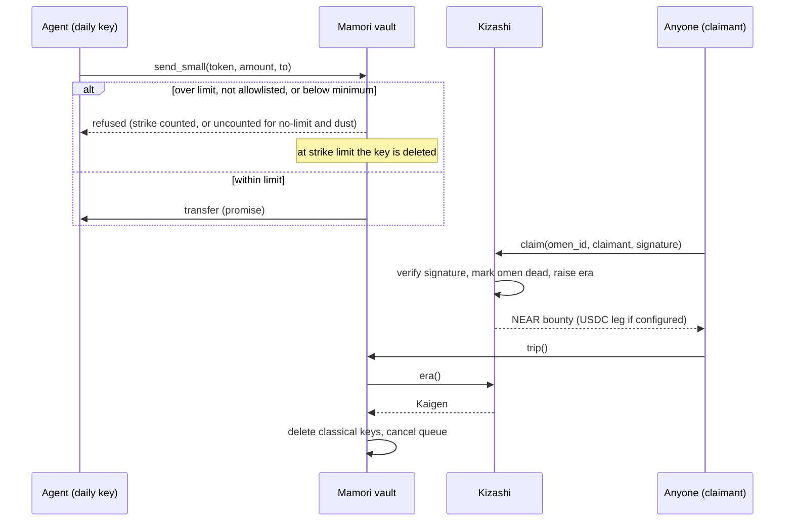

<p align="center"></p>

# KAIGEN: Keys that retire themselves

> **testnet-proven, not on mainnet, no outside audit.** A NEAR account whose keys delete themselves: a cold post-quantum admin key, and hot keys that cap themselves and burn after repeated misuse.

KAIGEN is a set of NEAR smart contracts and Node tooling for accounts that defend themselves. An account holds a cold admin key that signs with ML-DSA-65 (a post-quantum signature scheme), and any number of classical hot keys (for a person or an AI agent) that are rate-limited, capped in value, and deleted by the account after repeated refusals. An optional "omen" contract lets anyone who discloses a break of a classical curve trigger a permissionless lockdown of opted-in vaults, with no oracle and no admin. Status: **testnet-proven, not on mainnet, no outside audit.** Nothing is deployed to mainnet. The mainnet lock is staged behind an evidence gate and has not run.

[Source Code](https://github.com/Andrew-Kevin-007/KAIGEN). Demo post: `<!-- DEMO POST URL: Kevin adds after publishing -->`. There is no live demo yet; the app runs locally (see Getting Started).

---

## The Problem in one line

A NEAR account keeps accepting a key after that key is broken or stolen, and an AI agent holding a key can be talked into spending it, until someone notices and acts by hand.

| Failure mode | Why it survives today | What KAIGEN does instead |
| --- | --- | --- |
| A classical curve (ed25519, secp256k1) is broken | The account accepts its keys until someone deletes them by hand | An ML-DSA-65 admin key deletes classical keys; an omen claim, when someone discloses a break, triggers that deletion permissionlessly |
| An agent's hot key is prompt-injected or hijacked | A full-access key can move everything; a function-call key with no cap can still drain its balance | Function-call key, rolling 24 h send cap, allowlist, a queue the admin can cancel, and the key burns after three refusals |
| The owner has to watch every vault at once | Nobody online means no response | `trip` is callable by anyone and reads the era from Kizashi |

---

## Without KAIGEN vs With KAIGEN

| Situation | Without KAIGEN | With KAIGEN |
| --- | --- | --- |
| A classical key is broken | Keys keep working until a person deletes them | A vault in lockdown deletes its classical daily and intents keys on the next `trip` (testnet drill: see `fire-tests/`) |
| An agent is prompt-injected | The agent's key sends whatever it is asked to, or is refused by app logic only | The contract refuses sends above the 24 h limit, to non-allowlisted recipients, and burns the key after the strike limit |
| A large send is hijacked | It leaves at once | Sends above the direct-send limit wait in a queue the admin can cancel during the delay |
| Admin key | Often a full-access classical key | ML-DSA-65 full-access key that signs AddKey and DeleteKey |
| Who has to act | A human, after the fact | The account itself, on the chain's own rules |

---

## What Makes KAIGEN Unique

| Question | Answer |
| --- | --- |
| Why not just rotate to ML-DSA keys? | Rotation is the right long-term step, and KAIGEN uses an ML-DSA-65 key as the admin key. It does not cover hot keys: an ML-DSA key held by an agent can still be hijacked, so the caps and the burn are still needed. Rotation also needs someone to notice and act. KAIGEN's omen path does not need a person online. The ML-DSA admin flow is proven on testnet protocol 88 only; mainnet protocol 86 has not run it (gate G1). |
| What is an omen? | An optional public key that nobody holds. Whoever breaks it can sign a claim; the contract verifies the signature and moves the era. It is a circuit breaker for a break someone discloses. It is not a quantum early warning. |
| What does an omen not do? | It does not catch a silent attacker who never publishes a break. It does not catch a first-to-break state actor who keeps the break private. An omen key is not a canary: nothing says it breaks before the keys it sits beside. An omen proves a curve can be broken, not who broke it or how widely. |
| What stops a hijacked hot key? | Per token and account-wide (not per key): a 24 h rolling cap on direct sends, an allowlist, a queue for larger sends, and a strike count that deletes the key (see Fairness and Integrity Safeguards). |
| Is a refusal a failure? | No. A refusal returns a recorded result and counts as a strike. The key burns at the strike limit (default 3 inside 24 h). |

---

## Track and NEAR tech used

Track: **`security`** (AI Security & Defense). Fallback: **`open`** (Open Innovation). The track ids are from `HACKATHON.md`.

| NEAR feature | Used for | State |
| --- | --- | --- |
| Function-call access keys with allowance | Daily hot keys can call only `send_small` and `request_withdraw` on the vault (`add_daily_key`, `contracts/mamori/src/lib.rs`) | Built; tested on testnet |
| Full-access keys, AddKey and DeleteKey | Admin key rotation and deleting classical keys at lockdown | Built; tested on testnet |
| ML-DSA-65 full-access keys | Post-quantum admin key that deletes classical keys | Proven on testnet protocol 88; mainnet protocol 86 not run |
| Signature verification in the contract | Omen claims: ed25519 and secp256k1 (`verify`, `contracts/kizashi/src/lib.rs`) | Proven on testnet (`fire-tests/0001.json` to `0004.json`) |
| `intents.near` key registration | Lockdown removes keys recorded on `intents.near` | Code path present; method names unconfirmed (gate G4); not run on chain |
| 1Click (NEAR Intents) top-up | Server-side top-up route in `app/` | UI and routes present; USDC leg not run on chain |

---

## How It Works

1. A vault is an account. Its full-access key is an ML-DSA-65 key. Classical full-access keys are deleted once the ML-DSA key takes over (testnet drill: `fire-tests/0001.json` to `0004.json`).
2. Each hot key (human or agent) is a function-call key with an allowance. Mamori's `send_small` checks the 24 h rolling limit per token, the allowlist and the minimum send before it moves anything.
3. A larger send goes to a queue with a delay. The admin can cancel it during the delay. The queue and the rolling request budget are both capped by the pending limit.
4. A refusal is a strike against the calling key. At the strike limit the vault deletes that key from the account.
5. An omen is a public key on a curve. Whoever breaks it signs the claim message `KAIGEN/v1/claim\n<kizashi account>\n<omen id>\n<claimant>`. Kizashi verifies the signature, marks the omen dead, and raises the era.
6. Anyone can call `trip` on a vault. At `Warning` the vault pauses `send_small` and `request_withdraw`; anything already queued stays frozen and the admin can cancel it. At `Kaigen` it deletes its recorded classical daily and intents keys and cancels its queue.

---

## Architecture

### System overview

```
                 +-------------------------------------------+
                 |                  NEAR                     |
                 |                                           |
  omen claim     |   +-------------+   era()    +----------+ |
  (anyone) ----->|   |   Kizashi   |<-----------|  Mamori  | |  vault = account
                 |   | omens, era, |            |  (per    | |  + ML-DSA admin key
                 |   |   bounty    |            |  vault)  | |  + daily keys
                 |   +-------------+            +----+-----+ |  + intents keys
                 |                                   |       |
                 |                       send_small / request_withdraw
                 |                                   |       |
  agent / human  |                                   v       |
  (daily key) -------------------------------------> transfer |
                 |                                           |
                 +-------------------------------------------+
  jobs/ (Node): keeper (trip), watchers, verify, testnet rehearsal, mainnet tooling (dry-run)
  app/ (Next.js): era page, vault lookup, /migrate (key in browser), /bounty (1Click top-up)
```

### Lifecycle

| Phase | What happens | Where it is enforced |
| --- | --- | --- |
| Init | Kizashi takes its omens (8 max, ed25519 or secp256k1, warning or kaigen level); Mamori takes its daily limit and a delay of at least 24 h (production build) | `Kizashi::new`, `Mamori::init` |
| Operate | Daily keys send within the 24 h limit; larger sends queue | `send_small`, `request_withdraw`, `execute` |
| Strike | Refused calls count against the key; the key burns at the limit | `refuse` (line 703), burn at 712-714 |
| Warn | Era reaches `Warning`; `send_small` and `request_withdraw` pause, queued withdrawals stay frozen and cancellable | `trip`, `on_era` |
| Kaigen | Era reaches `Kaigen`; classical keys deleted; queue cancelled; cleanup continues over repeated `trip` calls | `trip`, `lock_down` |
| Lock (not done) | Kizashi's own access keys deleted, so it has no admin | `mainnet lock` (`jobs/src/mainnet.mjs`), gated |

---

## Sequence diagram



---

## Protocols and Standards

| Standard or protocol | Where | Notes |
| --- | --- | --- |
| NEAR access keys (function-call and full-access) | `mamori`, `chain.mjs` | Daily keys are function-call keys with allowance |
| ed25519 (RFC 8032) | `kizashi`, `scripts/omens.mjs` | Omen and claim verification |
| secp256k1 (ECDSA, low-s) | `kizashi`, `scripts/claim.mjs` | Omen and claim verification; `ecrecover` on chain |
| ML-DSA-65 (FIPS 204) | Admin key via `@fastnear/ml-dsa-65` | Testnet protocol 88 proof only |
| RFC 9380 hash-to-curve | `scripts/omens.mjs` | Omen keys derived from public seeds |
| sha256 | `kizashi` | Claim digests; secp256k1 signs sha256, not keccak256 (`contracts/kizashi/src/lib.rs`, lines 194-195) |
| NEAR Intents (`intents.near`) | `mamori` | Key removal path present; not run on chain |
| 1Click API | `app/app/api/topup/*` | Top-up quote and status routes; not run on chain |

---

## Contract addresses

| Contract | Network | Account | Where it is recorded |
| --- | --- | --- | --- |
| Kizashi (drill twin) | NEAR testnet | `kizashi.kaigen-g1-0170217f.testnet` | `fire-tests/0001.json` to `0004.json` |
| Mamori vault (drill) | NEAR testnet | `vault.kaigen-g1-0170217f.testnet` | `fire-tests/0001.json` to `0004.json` |
| Kizashi | NEAR mainnet | none deployed | `deployments.json` is not committed; `deployments.example.json` is the shape |

To create your own testnet accounts, run `node jobs/src/bin.mjs testnet`. It makes throwaway sub-accounts of one funded testnet account and prints their addresses; nothing it creates is committed.

---

## Fairness and Integrity Safeguards

| Rule | Enforced on-chain | Function | Limit and default |
| --- | --- | --- | --- |
| Direct sends are capped in 24 h | Yes | `send_small`, `spend` | Daily limit per token (`set_token_limit`) |
| Larger sends wait out a delay | Yes | `request_withdraw`, `execute` | Delay at least 24 h in the production build (`MIN_DELAY_SECS`); drill builds allow a short delay for rehearsal |
| Queued value is capped | Yes | `request_withdraw`, `fits_pending` | Pending limit: 10x the daily limit for NEAR; zero for a token with no daily limit |
| Requests per 24 h are capped | Yes | `request_withdraw`, `add_to_window` | Same size as the pending limit |
| Only allowlisted recipients | Yes, when enforced | `send_small`, `allow_recipient` | Allowlist up to 32 entries |
| Refused keys are burned | Yes | `refuse` | 3 strikes in 24 h by default; admin sets 1 to 10 (`set_max_strikes`) |
| Dust and no-limit tokens do not burn a key | Yes | `send_small`, `refuse_uncounted` | Minimum send 0.001 NEAR by default |
| Lockdown at Kaigen | Yes | `trip`, `lock_down` | Deletes daily and intents keys; repeat `trip` until empty |
| Warning pauses sends and new withdrawal requests | Yes | `trip`, `on_era` | Era `Warning` |
| Claim names its claimant | Yes | `claim`, `build_claim_message` | Copied signatures cannot redirect the bounty |
| Omen keys cannot be reused | Yes | `Kizashi::new`, `claim` | Duplicate, all-zero and small-order ed25519 keys are rejected; a dead omen cannot claim again |
| Drill reset is not in production | Yes | `reset` (drill feature only) | Refuses accounts that are not `.testnet` |

---

## Key Code

Omen claim, excerpt from `contracts/kizashi/src/lib.rs` (indentation trimmed):

```rust
let omen = self.omens.get(&omen_id).unwrap_or_else(|| env::panic_str("unknown omen"));
require!(omen.death.is_none(), "omen already dead");
let message = build_claim_message(&env::current_account_id(), &omen_id, &claimant);
require!(verify(omen, message.as_bytes(), &signature.0), "bad signature");
```

Refusal and burn, excerpt from `contracts/mamori/src/lib.rs` (indentation trimmed):

```rust
record.count += 1;
emit("refused", serde_json::json!({ "public_key": key, "reason": reason, "strikes": record.count, "counted": true }));
let burned = record.count >= self.max_strikes;
if burned {
    self.strikes.remove(key);
    self.daily_keys.remove(key);
```

Send guard, excerpt from `contracts/mamori/src/lib.rs` (indentation trimmed):

```rust
if self.limit_for(&token) == 0 {
    return PromiseOrValue::Value(self.refuse_uncounted(&key, NO_LIMIT_REASON));
}
if token.is_none() && amount.0 < self.min_send {
    return PromiseOrValue::Value(self.refuse_uncounted(&key, BELOW_MIN_REASON));
}
```

---

## Exact files and line numbers

<!-- Line numbers grepped on 1 Nov 2026 from the code as it stood. Re-check after any contract edit. -->

| What | File | Lines |
| --- | --- | --- |
| Kizashi: omen cap, init and key checks | `contracts/kizashi/src/lib.rs` | 28 (`MAX_OMENS`); 177 (`new`); 561 (`require_usable_ed25519`) |
| Kizashi: claim, signature check, era raise, payouts | `contracts/kizashi/src/lib.rs` | 218 (`claim`); 568 (`build_claim_message`); 572 (`verify`) |
| Kizashi: payout callbacks and events | `contracts/kizashi/src/lib.rs` | 260 (`on_near_payout`); 314 (`on_usdc_paid`) |
| Kizashi: owed payouts and USDC registration | `contracts/kizashi/src/lib.rs` | 342 (`retry_payout`); 377 (`register_usdc`) |
| Kizashi: views | `contracts/kizashi/src/lib.rs` | 387 (`era`); 391 (`omens`); 409 (`bounty`); 425 (`claim_message`) |
| Kizashi: drill-only reset | `contracts/kizashi/src/lib.rs` | 432 (`#[cfg(feature = "drill")]`); 433 (`reset`) |
| Mamori: constants (limits, strikes, pending multiple, min send, delay floor) | `contracts/mamori/src/lib.rs` | 17 (`DAY_NS`); 18 (`MAX_DAILY_KEYS`); 20 (`MAX_QUEUE`); 21 (`MAX_ALLOWED`); 28 (`MAX_WINDOW_ENTRIES`); 32 (`PENDING_LIMIT_MULTIPLE`); 34 (`DEFAULT_MIN_SEND`); 37 (`DEFAULT_ALLOWANCE`); 63 (`MIN_DELAY_SECS`) |
| Mamori: init and delay floor | `contracts/mamori/src/lib.rs` | 195 (`init`) |
| Mamori: admin setters | `contracts/mamori/src/lib.rs` | 226 (`add_daily_key`); 257 (`register_intents_key`); 267 (`set_token_limit`); 275 (`set_pending_limit`); 282 (`set_min_send`); 289 (`allow_recipient`); 303 (`set_max_strikes`); 290 (strike range check); 317 (`cancel`) |
| Mamori: send guard, 24 h cap, pause at warning | `contracts/mamori/src/lib.rs` | 343 (`send_small`); 692 (`spend`) |
| Mamori: queue, pending limit, 24 h request window | `contracts/mamori/src/lib.rs` | 383 (`request_withdraw`); 741 (`fits_pending`); 703 (`add_to_window`); 733 (`pending_limit_for`); 741 (`fits_pending`) |
| Mamori: execute, trip, lockdown | `contracts/mamori/src/lib.rs` | 413 (`execute`); 434 (`trip`, anyone); 444 (`on_era`); 478 (`lock_down`) |
| Mamori: strikes and burn | `contracts/mamori/src/lib.rs` | 760 (`cancel_queued_by`); 791 (`refuse`) |
| Mamori: refusal without strike | `contracts/mamori/src/lib.rs` | 783 (`refuse_uncounted`) |
| Tooling: CLI commands | `jobs/src/bin.mjs` | 97 (fire-test records written to `fire-tests/`); 136 (`judge` writes `judge-report.json`); 161 (`verify`); 164 (`verify` reads `fire-tests/`); 196 (`mainnet`) |
| Tooling: judge checks | `jobs/src/judge.mjs` | `checks()`: each claim, its command and evidence |
| Tooling: mainnet dry-run and lock | `jobs/src/mainnet.mjs` | whole file (dry-run by default) |
| App: migrate page, headers | `app/app/migrate/page.tsx`, `app/lib/security-headers.ts` | `security-headers.ts` 21-22 (COOP, CORP) |
| App: top-up guard | `app/lib/topup-guard.ts` | 25 (`guardConfigFromEnv`) |
| Fire-test records | `fire-tests/0001.json` to `0004.json` | whole files (drill, testnet) |

---

## Known gaps and out of scope

**Not on mainnet.** Nothing is deployed to mainnet. The ML-DSA admin flow is proven on testnet protocol 88; mainnet protocol 86 is the target and has not run it (gate G1). `jobs/src/mainnet.mjs` exists and is dry-run by default; it has not been run against mainnet.

**Caps, stated plainly.**

- A hijacked daily key can send up to the daily limit per token in any rolling 24 h (`spend`, `contracts/mamori/src/lib.rs`).
- It can queue up to the pending limit at once. The default pending limit for NEAR is 10x the daily limit, and zero for a token with no daily limit (`pending_limit_for`).
- It can request up to the pending limit again in each rolling 24 h (`request_withdraw`, `add_to_window`). Executing or cancelling a request does not return that budget.
- The production delay floor is 24 h (`MIN_DELAY_SECS`); drill builds use a short delay. A hijacked daily key can still queue up to the pending limit inside the rolling 24 h window until the admin cancels.
- Refusals are recorded successes, not reverts, so each refused call costs the vault a little gas before the key burns.

**Omen limits.** A silent attacker who never publishes a break triggers nothing. A first-to-break state actor who keeps the break private triggers nothing. An omen claim pays the whole bounty to the first claimant, including a warning-level omen. An omen does not say who broke the curve or how widely.

**Known gaps from the code and review (open or partly open):**

| Id | Where | Gap | Status |
| --- | --- | --- | --- |
| G1 | Admin flow | ML-DSA admin flow not run on mainnet protocol 86 | Open |
| G2 | Vault storage | Each vault deploys Mamori (about 3 NEAR of storage); global contracts untested | Open |
| G3 | App | Wallet-signed path to add an ML-DSA key is untested; the harness uses a classical key | Open |
| G4 | Intents | `add_public_key` and `remove_public_key` names on `intents.near` unconfirmed | Open |
| G7 | Hinomi | Source of top accounts not chosen | Open |
| K3 | Kizashi | A failed `ft_balance_of` read is emitted and recorded only as a read to repeat; the last omen's USDC has no automatic retry | Documented limit |
| - | Kizashi | Two claims close together can both read the full balance; the second transfer's failure is then booked as owed | Open |
| - | Kizashi | `retry_payout` drains in first-come order when several claimants are owed | Open |
| - | Mamori | If every `intents.near` removal keeps failing, intents keys can starve; gas figures come from the unit-test VM | Open |
| - | Mamori | One `trip` may not finish a lockdown; repeat until `intents_keys()` and `daily_keys()` are empty | Open; the keeper confirms by daily keys only |
| - | Tooling | The lock reads the chain through one RPC host; the gate file is unsigned; the deployer's full-access key on a Mamori reference is not flagged | Open |
| - | Verify | `node jobs/src/bin.mjs verify` reads `deployments.json`, which is not committed, so its fire-test checks cannot run from a fresh clone; it also has a freshness limit on fire-test records (`MAX_FIRE_TEST_AGE_BLOCKS`) | Open |
| - | App | `KIZASHI_CODE_HASH` must be set before any non-dry quote; otherwise top-ups return 503 by design | Config |
| - | App | The 1Click NEAR USDC asset id `nep141:<usdc_token>` is assumed, not checked against the live token list | Open |

**Fixed in the current code** (each one is visible in the code paths named in the table below): K1 payout registration and success or failure events (`on_usdc_paid`, `emit_payout_*`); K2 `reset` only in the drill feature; K3 `retry_payout` for owed payouts; K5 init key checks (`require_usable_ed25519`); S1 pending limit on queued value (`fits_pending`); S-queue requesting key recorded and queue cancelled on burn (`requested_by`, `cancel_queued_by`); S3 send-window bucketing and minimum send (`add_to_window`, `DEFAULT_MIN_SEND`); APP-1 `/migrate` headers (`app/lib/security-headers.ts`). APP-2 is not listed as fixed here because its code was not checked for this README.

**Not checked.** No outside audit. Builds are reproducible on one machine, not yet across machines. No gas measurement on a real mainnet chain.

---

## Phase 2 / not built

- Mainnet deployment, the mainnet drill pair, and the production Kizashi lock (plan sections B and C).
- Global contracts for Mamori (gate G2).
- A production withdrawal delay (owner decision).
- The Create vault page is in `app/app/vault/create/` behind `NEXT_PUBLIC_VAULT_CREATE`; it is off by default and has not been run against a chain.
- A signed gate file for `make verify`.
- The landing page in `site/` is being redesigned; it is described here only as the landing page.

---

## Tech Stack

| Layer | Tools |
| --- | --- |
| Contracts | Rust 1.99.1 (`rust-toolchain.toml`), `near-sdk` 5.30, `hex`; wasm32-unknown-unknown |
| Contract tests | `ed25519-dalek`, `k256`, `sha2` |
| Scripts and jobs | Node.js, `@fastnear/api`, `@fastnear/ml-dsa-65`, `@fastnear/utils`, `@noble/curves`, `@noble/hashes`, `@scure/base` |
| App | Next.js 16, React 19, `motion`, `@fastnear/wallet`, `@defuse-protocol/one-click-sdk-typescript` |
| Landing page | Next.js (`site/`) |

---

## Project Structure

```
kaigen/
├── contracts/
│   ├── kizashi/          omen registry: claim, era, bounty (src/lib.rs, src/tests.rs)
│   └── mamori/           vault guard: daily keys, send_small, queue, strikes, trip (src/lib.rs, src/tests.rs)
├── scripts/              omen derivation and claim signing; predeploy checks (omens.mjs, claim.mjs, predeploy.mjs)
├── jobs/
│   ├── src/              bin.mjs (CLI), judge, testnet, firetest, verify, keeper, watchers, demo, mainnet (dry-run)
│   └── test/             node:test suites for jobs/
├── app/                  Next.js app: /, /bounty, /migrate, /vault, /vault/create, top-up API routes
├── site/                 landing page
├── fire-tests/           published drill records (0001.json to 0004.json, testnet)
├── docs/                 PLAN-submission-and-mainnet.md, ARCHITECTURE-REVIEW.md
├── out/                  built wasm (created by make build; not committed)
├── deployments.example.json
├── Makefile              test, build, verify, verify-prelock, predeploy
└── rust-toolchain.toml   pinned toolchain
```

---

## Getting Started

### Prerequisites

- Rust 1.99.1 with the `wasm32-unknown-unknown` target. `rust-toolchain.toml` pins it, and rustup installs it on first use.
- Node.js. The author used Node v24.11.1. The packages have no `engines` field, so other versions are untested.
- `make` is optional. The Makefile says every target is a plain command, and the author's Windows machine has no `make`.
- **Windows:** set `AWS_LC_SYS_PREBUILT_NASM=1` before building. PowerShell: `$env:AWS_LC_SYS_PREBUILT_NASM = "1"`. Git Bash: `export AWS_LC_SYS_PREBUILT_NASM=1`.

### Install

```sh
cd jobs && npm ci && cd ..
cd scripts && npm ci && cd ..
cd app && npm ci && cd ..
```

### Configure

```sh
cp app/.env.example app/.env.local
```

Fill in each value you need. `app/.env.example` says what each variable does. Without `NEXT_PUBLIC_KIZASHI_ID`, the app says it is not deployed yet. Secrets (`ONECLICK_JWT`) belong in the environment only. `.env*` is git-ignored except `.env.example`.

### Run

```sh
cd app && npm run dev        # then open /migrate (no chain needed)
cd site && npm run dev       # landing page
```

### Deploy

Nothing is deployed to mainnet, and these steps are not run by the author. The owner runs them with their own keys.

```sh
make build                                                     # production wasm to out/prod
make predeploy INIT=<init.json> DRILL_KEYS=<drill-public-keys.json> USDC=<token account>
node jobs/src/bin.mjs mainnet gates                            # read-only checks
node jobs/src/bin.mjs mainnet plan                             # prints every transaction; sends nothing
```

`mainnet execute --stage N --yes` and `mainnet lock --i-understand-this-is-irreversible` send transactions. Each needs a key file outside the repo (`KAIGEN_DEPLOYER_KEY_FILE`). See `node jobs/src/bin.mjs mainnet help`.

The drill build for testnet (`out/drill`) is not in the Makefile. The Cargo features say how to build it: `--features drill` on the `kizashi` and `mamori` packages, and `--cfg near` (set in `.cargo/config.toml`). The author did not run this command as written here; treat it as unverified until you run it.

---

## Judge demo

Steps 1 to 2 need no funds and no chain. Step 4 needs one funded testnet account.

| # | Do this | You should see |
| --- | --- | --- |
| 1 | `make test`, or without make: `cargo test --workspace`, then `cd scripts && node --test omens.test.mjs predeploy.test.mjs`, then `cd jobs && node --test test/*.test.mjs` | Every suite ends with `0 failed`. Counts at the last run: Kizashi 60, Mamori 78 (`cargo test --workspace`, 0 failed); app 62 (`npm test`, 0 failed). jobs 149, scripts 20 (`node --test`, 0 failed). |
| 2 | `node jobs/src/bin.mjs judge` | A report of PASS or SKIPPED per claim, with the evidence line; it writes `judge-report.json`. A check that cannot run is SKIPPED with the reason, never PASS |
| 3 | Open `fire-tests/0003.json` | Claim, trip, post-quantum send and re-arm transactions for a drill vault, with the block where the classical keys were gone. Look the hashes up on a NEAR testnet explorer |
| 4 | `node jobs/src/bin.mjs testnet` (needs `out/drill`, see Deploy, and a funder file set by `KAIGEN_FUNDER_FILE` or the faucet) | About 8 minutes; PASS or FAIL per step: the ML-DSA admin, the claim on each curve, the lockdown, the injection demo ending with the burned key |
| 5 | `cd app && npm run dev`, open `/migrate` | An admin key is made in the browser, and an encrypted backup is required before anything else |

---

## Libraries, templates and AI-written code

**Libraries and templates used**

- Contracts: `near-sdk` 5.30 and `hex` (contracts); `ed25519-dalek` 2, `k256` 0.13, `sha2` 0.10 (tests).
- Scripts, jobs and app: the packages in `jobs/package.json`, `scripts/package.json` and `app/package.json`, listed under Tech Stack.
- Landing page: Next.js; `site/` is a landing page. Its origin and any template use should be checked against its `package.json` before submission (`<!-- SITE TEMPLATE: Kevin to confirm -->`).

**AI-written code.** The code in this repository was written with Claude Code (Anthropic). Separate Claude review agents reviewed the Rust contracts, the security surface and the TypeScript. Review findings and their fixes are recorded in [docs/ARCHITECTURE-REVIEW.md](docs/ARCHITECTURE-REVIEW.md). Kevin Andrew A owns every decision: the design, what ships, what is deployed, and what is claimed.

**Build window.** The window is the organiser's 19 Oct 2026 announcement to the submission close, 14 Nov 2026 23:59 UTC (`HACKATHON.md`, Q-001). This folder is not a git repository in the copy I checked, so the baseline before 19 Oct is not shown by commit history. `<!-- BASELINE: Kevin to add the pre-window tag or branch before submission -->`.

---

## License

MIT. See [LICENSE](LICENSE).
