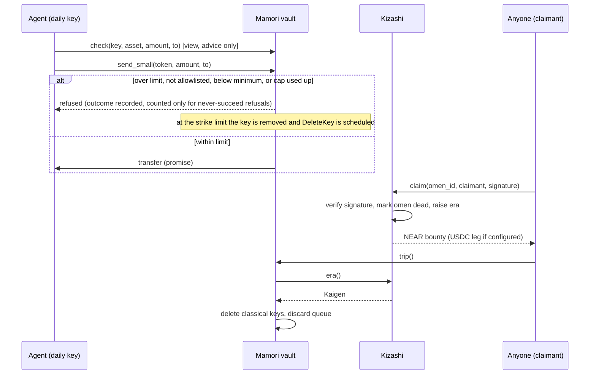

<p align="center"></p>

# KAIGEN: Keys that retire themselves

> **v3: testnet only, measured in a single-validator sandbox, no audit, not on mainnet.** A NEAR account whose hot keys cap themselves and burn after repeated refusals. The admin key is meant to be a post-quantum ML-DSA-65 key. The v3 sandbox used an ed25519 stand-in.

KAIGEN is a set of NEAR smart contracts and Node tooling for accounts that defend their hot keys. The account keeps an admin key. Any number of hot keys (for a person or an AI agent) are function-call keys. Each hot key is limited by a per-token cap over 24 hours, a queue with a delay for larger sends, an optional allowlist, and a strike count that deletes the key after repeated refusals.

An optional omen contract (Kizashi) lets anyone who discloses a break of a classical curve trigger a lockdown of opted-in vaults. The omen path has no oracle. Kizashi keeps an admin until its own lock, which is not done. [ARCHITECTURE.md section 1; THREAT-MODEL.md section 6; ROADMAP.md section 1 item 8]

**Status (v3, 2026-11-03).**

- Testnet only. No outside audit. Nothing is deployed to mainnet. KAIGEN has not run on mainnet. [ROADMAP.md section 3]
- The v3 numbers come from one single-validator nearcore 2.14.0 sandbox (protocol 88, 128 ms blocks). The vault admin was an ed25519 key standing in for ML-DSA. [ATTACK-RESULTS.md section 0]
- The timed attacks used a fast-forwarded chain clock. [ATTACK-RESULTS.md section 14]
- The hash-pinned global contract for Mamori (M6) is not built. [ROADMAP.md section 2; ARCHITECTURE.md section 3]
- The Create vault page (`app/app/vault/create/`) has not been run against a chain. It is enabled on testnet only.
- v2 was deployed as drill records on testnet. v3 has no testnet deployment in the sources. [LANDSCAPE.md section 3]

[Source Code](https://github.com/Andrew-Kevin-007/KAIGEN). Demo post: `<!-- DEMO POST URL: Kevin adds after publishing -->`. There is no live demo yet; the app runs locally (see Getting Started).

Design documents for v3 are in [docs/v3/](docs/v3/README.md). The v2 to v3 change list, including the breaking change, is in [docs/v3/CHANGES-V2-TO-V3.md](docs/v3/CHANGES-V2-TO-V3.md).

---

## The Problem in one line

A NEAR account keeps accepting a key after that key is broken or stolen, and an AI agent holding a key can be talked into spending it, until someone notices and acts by hand.

| Failure mode | Why it survives today | What KAIGEN does |
| --- | --- | --- |
| A classical curve (ed25519, secp256k1) is broken | Classical keys stay on the account until someone deletes them `<!-- UNVERIFIED: general premise -->` | The ML-DSA-65 admin key deletes classical keys at lockdown. An omen claim, when someone discloses a break, raises the era, and `trip` then deletes the recorded classical keys. [ARCHITECTURE.md section 1] |
| An agent's hot key is prompt-injected or hijacked | The allowance on a function-call key is a gas budget, not a value cap | Per-token 24 h cap, allowlist (off by default), a queue with a delay for larger sends, and a strike count that burns the key. [LOSS-BOUND.md section 3, E1 to E9] |
| The owner has to watch every vault at once | Nobody online means no response | `trip` reads the era from Kizashi. Anyone can call it. [ATTEST-CHECK.md section 5] `<!-- UNVERIFIED in v3 sources: "anyone can call trip" is from the old v2 line table; the v3 code shows trip(&self) with no admin argument. -->` |

---

## Plain NEAR account and KAIGEN

The left column is the design premise. It was not measured. The right column lists what the v3 code and the sandbox showed.

| Situation | Plain NEAR account (premise) | With KAIGEN (v3, measured or tested) |
| --- | --- | --- |
| A classical key is broken | The key keeps working until a person deletes it | Lockdown at Kaigen deletes the recorded classical daily and intents keys, and repeat `trip` calls finish the job. Not measured end to end in v3. [ATTEST-CHECK.md section 5; ARCHITECTURE.md section 2.1] |
| An agent is prompt-injected | The key sends whatever it is asked, subject to its gas allowance | Over-cap sends, sends to unlisted payees (when the allowlist is on) and dust are refused. Three counted refusals burn the key. Attacks 1 and 7 PASS. [ATTACK-RESULTS.md attacks 1 and 7] |
| A large send is hijacked | It leaves at once | Sends above the direct-send limit wait in a queue for at least 24 h. The admin can cancel during the wait. Attacks 5 and 6 PASS. [ATTACK-RESULTS.md attacks 5 and 6] |
| Admin key | Often a classical full-access key `<!-- UNVERIFIED: general premise -->` | ML-DSA-65 full-access key in the design. The sandbox admin was ed25519. [ATTACK-RESULTS.md section 0] |
| Who has to act | A person, after the fact | The contract refuses, counts and burns on its own rules. A person still has to cancel or re-key. [ARCHITECTURE.md section 4] |

---

## What the guard is, and what it is not

| Question | Answer |
| --- | --- |
| Why not just rotate to ML-DSA keys? | Rotation is the long-term step, and the v3 admin key is ML-DSA-65. Rotation does not cap hot keys. An ML-DSA key held by an agent can still be hijacked, so the cap and the burn are still needed. [THREAT-MODEL.md section 4; NOVELTY-CLAIMS.md section 3] |
| What is an omen? | A public key on ed25519 or secp256k1. Whoever breaks it can sign a claim. The contract verifies the signature, marks the omen dead and raises the era. It is a circuit breaker for a break someone discloses. It is not an early warning. [THREAT-MODEL.md section 6] |
| What does an omen not do? | It does not catch a silent attacker who never publishes a break. It does not catch a state actor who keeps a break private. It is not a canary: nothing says it breaks before the keys beside it. It does not say who broke the curve or how widely. [THREAT-MODEL.md sections 4 and 6] |
| What stops a hijacked hot key? | Per token, account-wide (not per key): a 24 h cap on direct sends, an allowlist (off by default), a queue with a delay for larger sends, and a strike count that burns the key. [LOSS-BOUND.md section 1] |
| What does a calibrated attacker do? | It reads `check` for its headroom and sends exactly the cap, with zero strikes. The loss is one cap per token per window. The counter does not stop this. [ATTACK-RESULTS.md attack 2; ATTEST-CHECK.md section 3.3] |
| Is a refusal a failure? | Not for `send_small`. A refusal returns a recorded outcome and nothing moves. It counts as a strike only when it can never succeed for an honest key. The key burns at the strike limit (default 3 inside 24 h, ceiling 10). `request_withdraw` refusals panic and are not counted. [ATTEST-CHECK.md section 4; ROADMAP.md Q-ABI] |
| Does a counted refusal ever hit an honest key? | Yes. A false burn was measured in a scripted honest trace. Its queued requests were cancelled and the key's request budget stayed spent for 24 h. The admin re-added the key. [ATTACK-RESULTS.md section 11.3] |

---

## Track and NEAR tech used

Track: **`security`** (AI Security & Defense). Fallback: **`open`** (Open Innovation). `<!-- UNVERIFIED in v3 sources: track ids and the HACKATHON.md reference; the file is not in this repository. -->`

| NEAR feature | Used for | State |
| --- | --- | --- |
| Function-call access keys with allowance | Daily keys can call only `send_small` and `request_withdraw` on the vault (`add_daily_key`). [LOSS-BOUND.md E6] | Tested on the sandbox (attacks 1 to 9). No v3 testnet run. |
| Full-access keys, AddKey and DeleteKey | Admin key rotation, and deleting keys on burn and at lockdown | Sandbox tested with an ed25519 admin. A burned key is removed from the account in the block after the burn decision. [V3-M1-PROGRESS.md; ATTACK-RESULTS.md section 11.1] |
| ML-DSA-65 full-access keys | Post-quantum admin key | Proven on testnet protocol 88 only. Mainnet protocol 86 has not run it (gate G1). [ROADMAP.md section 3] |
| Signature verification in the contract | Omen claims: ed25519 and secp256k1 (Kizashi) | Unit-tested in v3. The v2 testnet records are the only on-chain proof in the sources. `<!-- UNVERIFIED in v3 sources: "proven on testnet (fire-tests/0001.json to 0004.json)" -->` |
| `attest()` and `check()` views | Posture and pre-flight | Implemented and unit-tested. `attest()` read by cage-check on the sandbox. [ATTEST-CHECK.md; V3-W2-CAGE-PROGRESS.md] |
| `intents.near` key registration | Lockdown removes recorded keys on `intents.near` | Code path present. Method names unconfirmed (gate G4). Not run on chain. [ROADMAP.md section 3] |
| 1Click (NEAR Intents) top-up | Top-up route in `app/` | UI and routes present. USDC leg not run on chain. `<!-- UNVERIFIED in v3 sources: app details -->` |

---

## How It Works

1. A vault is an account. Its full-access key is the admin key. Classical full-access keys must not be on the account. cage-check reports a red row if one is. [THREAT-MODEL.md section 1; ARCHITECTURE.md section 2.8]
2. Each hot key (human or agent) is a function-call key with an allowance (default 0.25 NEAR, a gas budget outside the cap). It can call only `send_small` and `request_withdraw`. [LOSS-BOUND.md A3; ARCHITECTURE.md section 2.3]
3. `send_small` decides in this order: key, era, amount, allowlist, token limit, minimum send, 24 h window. `check` runs the same function and reports what `send_small` would do. [ATTEST-CHECK.md sections 3 and 4]
4. A larger send goes to a queue. It is locked for at least 24 h and expires 24 h after it unlocks. The admin can cancel it during the lock. Queued value is capped at the pending limit per token. [LOSS-BOUND.md sections 1 and 2.2; V3-MAMORI-PROGRESS.md step 1]
5. A counted refusal is a strike against the calling key. At the limit, the vault removes the key from its records, cancels that key's queued requests, and schedules a DeleteKey. The key is refused from the next call and deleted from the account a block later. [ATTACK-RESULTS.md section 11.1]
6. An omen is a public key on a curve. Whoever breaks it signs a claim. Kizashi verifies the signature, marks the omen dead and raises the era. [THREAT-MODEL.md section 6; V3-KIZASHI-PROGRESS.md] `<!-- UNVERIFIED in v3 sources: the claim message layout beyond the domain string KAIGEN/v1/claim, and the bounty rules. -->`
7. Anyone can call `trip` on a vault `<!-- UNVERIFIED in v3 sources: "anyone" is from the old v2 line table -->`. At `Warning` the vault pauses `send_small` and `request_withdraw`. Queued requests stay in the queue, and the admin can cancel them. At `Kaigen` the vault deletes its recorded classical daily and intents keys, and discards its queue. Repeat `trip` until both lists are empty. [ATTEST-CHECK.md section 5; LOSS-BOUND.md section 2.5]
8. `cage-check` reads the account's keys from RPC, reads `attest()`, and reports GREEN, RED or UNKNOWN. It is a point-in-time check. [ATTEST-CHECK.md section 2.3; V3-W2-CAGE-PROGRESS.md]

---

## Architecture

### System overview

```
                 +-------------------------------------------+
                 |                  NEAR                     |
                 |                                           |
  omen claim     |   +-------------+   era()    +----------+ |
  (anyone) ----->|   |   Kizashi   |<-----------|  Mamori  | |  vault = account
                 |   | omens, era, |            |  (per    | |  + ML-DSA admin key
                 |   |   bounty    |            |  vault)  | |  + daily keys
                 |   +-------------+            +----+-----+ |  + intents keys
                 |                                   |       |
                 |                       send_small / request_withdraw
                 |                                   |       |
  agent / human  |                                   v       |
  (daily key) -------------------------------------> transfer |
                 |                                           |
                 +-------------------------------------------+
  jobs/ (Node): keeper (trip), watchers, verify, cage-check, testnet rehearsal, mainnet tooling (dry-run)
  app/ (Next.js): era page, vault lookup, /migrate (key in browser), /bounty (1Click top-up)
  tests-integration/ (Rust, near-workspaces): burned-key deletion, cage-check on a sandbox, nine attacks
```

### Lifecycle

| Phase | What happens | Where it is enforced |
| --- | --- | --- |
| Init | Kizashi takes up to 8 omens. Mamori takes its daily limit and a delay of at least 24 h (production build). | `Kizashi::new`, `Mamori::init`; `min_delay_secs` in `attest()` [ATTEST-CHECK.md section 2.1] |
| Operate | Daily keys send within the 24 h cap. Larger sends queue. | `send_small`, `request_withdraw`, `execute`, `check` |
| Strike | Counted refusals count against the key. The key burns at the limit. | `judge_send` decides, `refuse` records [V3-W2-EDITH-PROGRESS.md M5a] |
| Warn | Era reaches `Warning`. `send_small` and `request_withdraw` pause. Queued requests stay frozen and cancellable. | `trip`, `on_era` |
| Kaigen | Era reaches `Kaigen`. Recorded classical daily and intents keys are deleted. The queue is discarded. Repeat `trip` until empty. | `trip`, `lock_down`, event `lockdown_partial` |
| Verify | cage-check and `attest()` report state. | `jobs/src/cage.mjs` |
| Lock (not done) | Kizashi's own access keys deleted, so it has no admin. | `mainnet lock` (`jobs/src/mainnet.mjs`), gated. Not run. |

---

## Sequence diagram



---

## Interfaces (v3)

| Method | Caller | Notes |
| --- | --- | --- |
| `send_small(token, amount, to)` | Daily key | Returns `SendOutcome`. Refusals are recorded outcomes. Zero amount and a non-daily key are panics. [ATTEST-CHECK.md section 4] |
| `request_withdraw(token, amount, to)` | Daily key | Returns the request id (U64, unchanged). Refusals panic and are not counted. Stores `expires_at`. [ROADMAP.md Q-ABI; V3-MAMORI-PROGRESS.md step 1] |
| `execute(id)` | Anyone | After the unlock time, before expiry, with the era calm. Refuses an expired request. [LOSS-BOUND.md E5; V3-MAMORI-PROGRESS.md step 1] |
| `cancel(id)` | Admin | Cancels one request. |
| `cancel_all()` | Admin | New in v3. Returns the count. [V3-MAMORI-PROGRESS.md step 2] |
| `purge_expired()` | Anyone | New in v3. Removes expired requests. Returns the count. [V3-MAMORI-PROGRESS.md step 2] |
| `check(key, asset, amount, to)` | View | New in v3. Advice only. Can be stale. [ATTEST-CHECK.md section 3] |
| `attest()` | View | New in v3. The state the contract records about itself. It does not return a code hash or a key list. [ATTEST-CHECK.md sections 2.1 and 2.2] |
| `strikes_of(key)` | View | Strikes in the current 24 h window. |
| `add_daily_key(key, allowance)` | Admin | Refuses a key that is revoked but not yet deleted from the account. [V3-W2-EDITH-PROGRESS.md M4a] |
| `remove_daily_key(key)` | Admin | Removes a key and schedules DeleteKey. |
| `register_intents_key(key)` | Admin | Records a key on `intents.near`. Such a key signs there with no Mamori cap. [ARCHITECTURE.md section 2.6] |
| `set_token_limit`, `set_pending_limit`, `set_min_send`, `allow_recipient`, `set_max_strikes`, `enforce_allowlist` | Admin | `set_max_strikes` accepts 1 to 10. [contracts/mamori/src/lib.rs] |
| `trip()` | Anyone | Reads the era from Kizashi and applies it. |

Admin methods require `predecessor == current account`. A daily key cannot reach them, because the runtime restricts a function-call key to two methods. [ARCHITECTURE.md section 2.2]

---

## Reason codes

The code is the stable name. The text is what `SendOutcome.refused` and the panics say. The text is unchanged from v2. `counted` is whether the refusal is a strike. [ATTEST-CHECK.md section 4]

| Code | Verdict | Counted | Text |
| --- | --- | --- | --- |
| `ok` | allow | no | `ok` (only in `check`) |
| `not_allowlisted` | refuse | yes | `recipient is not on the allowlist` |
| `over_cap_total` | refuse | yes | `over the 24 h limit` (amount above the whole 24 h cap) |
| `cap_exhausted` | refuse | no | `over the 24 h limit` (cap used up by earlier spend, possibly by another key) |
| `no_limit` | refuse | no | `no 24 h limit is set for this token` |
| `below_min_send` | refuse | no | `below the minimum send` |
| `not_a_daily_key` | reject | no | `not a recorded daily key` |
| `era_not_calm` | reject | no | `paused: era is not calm` |
| `zero_amount` | reject | no | `amount must be > 0` |
| `transfer_failed` | (none) | no | `the transfer failed and was refunded to the daily limit` (an outcome from the callback, not from `check`) |

Two codes share one text. Read the code, not the text, to tell them apart.

---

## Protocols and Standards

| Standard or protocol | Where | Notes |
| --- | --- | --- |
| NEAR access keys (function-call and full-access) | `mamori`, `chain.mjs` | Daily keys are function-call keys with allowance |
| ed25519 (RFC 8032) | `kizashi`, `scripts/omens.mjs` | Omen and claim verification |
| secp256k1 (ECDSA, low-s) | `kizashi`, `scripts/claim.mjs` | Omen and claim verification. `<!-- UNVERIFIED in v3 sources: ecrecover and the sha256 digest -->` |
| ML-DSA-65 (FIPS 204) | Admin key | Testnet protocol 88 proof only. The locked near-sdk 5.30 has an `MLDSA65` curve type and an ML-DSA verify host function. What the host returns for an ML-DSA signer is unverified. [V3-W2-EDITH-PROGRESS.md] |
| RFC 9380 hash-to-curve | `scripts/omens.mjs` | Omen keys derived from public seeds. `<!-- UNVERIFIED in v3 sources -->` |
| sha256 | `kizashi` | Claim digests. `<!-- UNVERIFIED in v3 sources: line references -->` |
| NEAR Intents (`intents.near`) | `mamori` | Key removal path present. Not run on chain. |
| 1Click API | `app/app/api/topup/*` | Top-up quote and status routes. Not run on chain. |

---

## Contract addresses

| Contract | Network | Account | Where it is recorded |
| --- | --- | --- | --- |
| Kizashi (v2 drill twin) | NEAR testnet | `kizashi.kaigen-g1-0170217f.testnet` `<!-- UNVERIFIED in v3 sources; v2 contract, not redeployed for v3 -->` | `fire-tests/0001.json` to `0004.json` (v2) |
| Mamori vault (v2 drill) | NEAR testnet | `vault.kaigen-g1-0170217f.testnet` `<!-- UNVERIFIED in v3 sources; v2 contract -->` | `fire-tests/0001.json` to `0004.json` (v2) |
| Mamori v3 | NEAR testnet | none deployed | Not in any source. v3 vaults must be deployed fresh. [CHANGES-V2-TO-V3.md section 1] |
| Kizashi | NEAR mainnet | none deployed | `deployments.json` is not committed. `deployments.example.json` is the shape. |

To create your own testnet accounts, run `node jobs/src/bin.mjs testnet`. It makes throwaway sub-accounts of one funded testnet account and prints their addresses. Nothing it creates is committed. `<!-- UNVERIFIED in v3 sources: CLI command -->`

---

## Fairness and Integrity Safeguards

| Rule | Enforced on-chain | Function | Limit and default |
| --- | --- | --- | --- |
| Direct sends are capped in 24 h, per token, account-wide | Yes | `send_small`, `check` | Cap per token (`set_token_limit`). NEAR cap is `daily_limit`. A token with no admin-set cap cannot be sent. [LOSS-BOUND.md C_T, E1, E2] |
| Larger sends wait out a delay | Yes | `request_withdraw`, `execute` | At least 24 h in a production build. `init` refuses a shorter delay (E4). A `drill` build accepts any delay. [LOSS-BOUND.md E4] |
| Queued requests expire | Yes | `execute`, `purge_expired` | 24 h after the unlock time. [V3-MAMORI-PROGRESS.md step 1] |
| Queued value is capped per token | Yes | `request_withdraw`, queue room check | Pending limit P. Default 10 times the cap. Zero for a token with no cap unless the admin sets one. [LOSS-BOUND.md section 1] |
| Requests per 24 h are capped | Yes | `request_withdraw` | Budget of P per token per rolling 24 h. Executing or cancelling does not return it. [ATTACK-RESULTS.md attack 4b] |
| Per-key shares | Yes | `request_withdraw`, queue room check | With n recorded keys: `MAX_QUEUE / n` requests, `P / n` queued value, `P / n` budget per key. Account-wide limits still apply. [LOSS-BOUND.md section 1] |
| Only allowlisted recipients (when enforced) | Yes, when enforced | `send_small`, `allow_recipient` | Off by default. Up to 32 entries (`MAX_ALLOWED`). `request_withdraw` and `execute` can pay any payee. [LOSS-BOUND.md A10] |
| Refused keys are burned | Yes | `refuse` | 3 counted refusals in 24 h by default. Admin sets 1 to 10. [ARCHITECTURE.md section 2.1] |
| Only never-succeed refusals count | Yes | `judge_send` | Counted: `not_allowlisted`, `over_cap_total`. Uncounted: `cap_exhausted` and the rest. [ATTEST-CHECK.md section 4] |
| Re-adding a burned key | Yes | `add_daily_key` | Refused while the DeleteKey is unconfirmed. Re-adding after confirmation is allowed (admin only). [ATTACK-RESULTS.md section 11.3] |
| Dust and no-limit tokens do not burn a key | Yes | `send_small` | Minimum send 0.001 NEAR by default. [ATTACK-RESULTS.md section 0] |
| Lockdown at Kaigen | Yes | `trip`, `lock_down` | Deletes recorded daily and intents keys. Repeat `trip` until empty. [ATTEST-CHECK.md section 5] |
| Warning pauses sends and new withdrawal requests | Yes | `trip`, `on_era` | Era `Warning` |
| Omen keys cannot be reused | Yes | `Kizashi::new`, `claim` | `<!-- UNVERIFIED in v3 sources: duplicate, all-zero and small-order ed25519 keys rejected; a dead omen cannot claim again -->` |
| Drill reset is not in production | Yes | `reset` (drill feature only) | `<!-- UNVERIFIED in v3 sources -->` Refuses accounts that are not `.testnet`. |

---

## Measured results (v3, sandbox)

Sandbox: one validator, nearcore 2.14.0, protocol 88, 128 ms blocks, ed25519 admin, WSL. Vault configuration: cap 1 NEAR per 24 h, delay 86,400 s, 3 strikes (attack 1c uses 10), pending limit 10 NEAR, minimum send 0.001 NEAR. [ATTACK-RESULTS.md sections 0 and 13]

"PASS" means the attack's own asserted conditions held. It does not mean the contract is secure. [ATTACK-RESULTS.md section 14]

| # | Attack | Result | Headline numbers |
| --- | --- | --- | --- |
| 1 | Clumsy agent: over-cap or unlisted sends until burn | PASS (1a, 1b, 1c) | Loss 0 NEAR in all three. Key off the account 1 block after the burn decision. First attempt to deletion: 11 blocks (N=3), 46 blocks (N=10). [section 2] |
| 2 | Calibrated attacker: sends exactly the cap, reads `check` | PASS (2a, 2b, 2c) | 2a: loss 1 NEAR = one cap, 0 strikes, 4 sends. 2c: 11 NEAR in one 24 h window = cap + pending, with the chain clock moved a day. [section 3] |
| 3 | Burst of in-cap sends | PASS (3a, 3b, 3c) | 3a and 3b: loss 1 NEAR. 3c (default 0.25 NEAR allowance): 8 of 40 calls taken, loss 0.8 NEAR. [section 4] |
| 4 | Queue flood by one key | PASS (4a, 4b) | 4a: 16 of 40 requests accepted (count cap 32). Honest key still accepted. 4b: queued sum equal to the pending limit (10 NEAR). `cancel_all` removes 17 entries. [section 5] |
| 5 | Stale queue item | PASS | Stale requests did not execute. `purge_expired` removed 2. 0 NEAR reached the payee. [section 6] |
| 6 | New payee through `request_withdraw` | PASS | 5 NEAR queued with no strike. Execute before unlock: "still locked". Cancelled 11 blocks later. 0 NEAR to the payee. [section 7] |
| 7 | Decimal-misread sends | PASS | Token (6 decimals, cap 100): 55.005 tokens held by the attacker in total, within the bound of 1,100 tokens. NEAR: 0.5 NEAR. The NEP-141 used is a look-alike fixture, not a real token. [section 8] |
| 8 | Planted full-access and null-allowance keys | PASS | cage-check RED on each planted key (ARCH-2.8-1, ARCH-2.8-3, ARCH-2.8-6), GREEN after removal. Stand-in admin, not a production result. [section 9] |
| 9 | Cross-key grief: key A uses the cap, honest key B | PASS (9, 9b) | B refused 11 times with 0 strikes. B succeeded 86,525 chain seconds after A's spend. A control with counted refusals burned at strike 3. [section 10] |

### Blocks to key deletion

| Case | Burn decision block | DeleteKey receipt block (key off the account) | Last callback block |
| --- | --- | --- | --- |
| Burn by 3 over-cap sends | 88 | 89 | 91 |
| Burn by 3 unlisted-payee sends | 159 | 160 | 162 |
| Burn by 10 over-cap sends | 272 | 273 | 275 |

[ATTACK-RESULTS.md section 11.1]

### Gas (sandbox, Tgas, summed over the transaction and its receipts)

| Call | Gas (Tgas) |
| --- | --- |
| `send_small`, sent | about 5.6 |
| `send_small`, refused and uncounted | about 2.8 |
| `send_small`, refused and counted (strike 1 or 2) | about 2.9 |
| `send_small`, the burning refusal | 6.9 |
| `request_withdraw` | 3.0 to 3.4 |
| `add_daily_key` (admin) | 5.5 |
| `remove_daily_key` (admin) | 6.1 |

[ATTACK-RESULTS.md section 11.2]

### Strike cost in a scripted honest trace

These traces were written by us. They are not recorded agent behaviour. The mistake mix was chosen by us. [ATTACK-RESULTS.md section 11.3]

- Counted mistakes: a first payment to a vendor not yet on the allowlist, and a legitimate payment above the whole 24 h cap.
- Uncounted: dust below the minimum send, a token with no limit, a cap used up by earlier honest spending, and a request above the pending limit.
- Three seeds (80 operations each) burned the key after 3 counted mistakes. Every later operation was refused by the runtime.

### Loss-bound checks

- Property test: sequences of up to nine daily keys, three tokens, and time jumps aimed at window edges. The bound held after every step. The default run is 300 seeds. The soak of 4,000 seeds had 0 violations. [LOSS-BOUND.md section 4]
- Peaks in the soak: sends exactly 100% of the cap, queue executions exactly 100% of the pending limit, and the total exactly 100% of cap plus pending limit, never above. [LOSS-BOUND.md section 4]
- Mutation checks: 16 mutations of `lib.rs`. Seven break the bound itself in a production build. One more (M06b, the request budgets) breaks it only in a drill build. The others are caught only by bookkeeping checks. [LOSS-BOUND.md section 5]

### Limits of these numbers

- Testnet was not run. Mainnet was not run. Every number is from one sandbox. Block counts carry over to testnet. The chain-millisecond figures do not. [ATTACK-RESULTS.md section 13]
- The admin was ed25519. The ML-DSA admin flow is not covered by these numbers. [ATTACK-RESULTS.md section 13]
- Not exercised on a chain: eight daily keys at once, registered intents keys, a non-NEAR token in the queue, the failed-transfer refund and requeue paths (covered by unit and property tests only), and the ML-DSA admin. [ATTACK-RESULTS.md section 13]
- The timed attacks (2c, 5, 9b, and the strike lapse) moved the chain clock by a day with `sandbox_fast_forward`. The contract reads that clock, so the 24 h rules were exercised without waiting. [ATTACK-RESULTS.md section 14]
- Admin response time (a person noticing and acting) was not measured. [ATTACK-RESULTS.md section 13]
- Leash and near-agent-spend-guard were not run. No comparison with them is made. [ROADMAP.md M9; NOVELTY-CLAIMS.md section 5]

---

## Loss bound

For every token T and every window of 24 h of block time, when the withdrawal delay is at least 24 h:

    loss_T(window) <= C_T + P_T

- C_T is the 24 h cap of the token.
- P_T is the pending limit. The default is 10 times C_T, so the default bound is 11 times C_T.
- The bound is in token units, with no price. Each token has its own bound.
- Over a span of L, the loss is at most ceil(L / 24 h) times (C_T + P_T). The bound does not limit a slow drain repeated every day.

The bound holds only while these conditions hold. Assumed conditions are not checked by the contract. [LOSS-BOUND.md section 3]

- The delay is at least 24 h. Below 24 h, the bound becomes C_T + 2 P_T (drill builds only).
- No classical full-access key, and no function-call key the vault does not record. Checked at a point in time by cage-check.
- No key registered on `intents.near`. Balances there are outside the bound.
- Gas allowances are outside the cap (up to 8 keys, 0.25 NEAR each by default).
- The admin reviews the queue during the delay. Otherwise the queued part executes.
- A transfer's failure callback arrives within 24 h of the call. Receipts are assumed to resolve in seconds.
- The configuration (cap, pending limit, allowlist, strike limit) does not change inside a window.
- A listed NEP-141 moves exactly the amount it is told to.

Not bounded: repeated in-cap drain over many windows, a calibrated attacker who reads `check` and sends exactly the cap, admin or cold-key compromise, and balances on `intents.near`. [LOSS-BOUND.md section 3; THREAT-MODEL.md section 4]

The derivation is an argument from the code plus property tests. It is not a machine-checked proof. [LOSS-BOUND.md header]

---

## Key Code

The v2 excerpts were removed because they pointed at v2 line numbers. The v3 functions to read are:

| Function | File | What it does |
| --- | --- | --- |
| `judge_send` | `contracts/mamori/src/lib.rs` | One decision for `send_small` and `check` |
| `refuse`, `refuse_uncounted` | `contracts/mamori/src/lib.rs` | Records a refusal, counts it or not, and burns at the limit |
| `queue_room`, `fits_pending` | `contracts/mamori/src/lib.rs` | Per-key and account-wide room in the queue |
| `build_claim_message`, `verify` | `contracts/kizashi/src/lib.rs` | Omen claim message and signature check |
| `on_usdc_balance` | `contracts/kizashi/src/lib.rs` | Refuses a balance read ordered under an older `usdc_epoch` |

---

## Exact files

Line numbers were removed. They moved when v3 was added. Use function names. For the line numbers at the older hash, see [docs/v3/LOSS-BOUND.md](docs/v3/LOSS-BOUND.md), which says which hash they refer to.

| What | File |
| --- | --- |
| Mamori: constants (`MAX_QUEUE` 32, `MAX_DAILY_KEYS` 8, `MAX_ALLOWED` 32, `PENDING_LIMIT_MULTIPLE` 10, `MIN_DELAY_SECS` 86,400, `EXECUTE_WINDOW_SECS` 86,400) | `contracts/mamori/src/lib.rs` |
| Mamori: views (`attest`, `check`, `strikes_of`, `config`) | `contracts/mamori/src/lib.rs` |
| Mamori: tests (loss-bound property test, attest, check, events, admin surface) | `contracts/mamori/src/tests/` |
| Kizashi: omen cap (`MAX_OMENS` 8), claim, signature check, payouts, `usdc_epoch` | `contracts/kizashi/src/lib.rs` |
| cage-check (ten rows, exit codes) | `jobs/src/cage.mjs`, `jobs/src/bin.mjs` |
| Sandbox attack suite and results | `tests-integration/tests/attacks/`, `docs/v3/ATTACK-RESULTS.md` |
| Sandbox start and stop (Windows, WSL) | `tests-integration/sandbox/start.ps1`, `stop.ps1` |
| Mainnet tooling (dry-run by default) | `jobs/src/mainnet.mjs` |
| Fire-test records (v2, testnet) | `fire-tests/0001.json` to `0004.json` `<!-- UNVERIFIED in v3 sources -->` |

---

## Known gaps and out of scope

**Not on mainnet.** Nothing is deployed to mainnet. The ML-DSA admin flow is proven on testnet protocol 88 only. Mainnet protocol 86 has not run it (gate G1). `jobs/src/mainnet.mjs` is dry-run by default and has not been run against mainnet. [ROADMAP.md section 3]

**Caps, stated plainly.**

- A hijacked daily key can send up to the cap per token in any rolling 24 h window. [LOSS-BOUND.md section 1]
- It can queue up to the pending limit. The default pending limit is 10 times the cap. [LOSS-BOUND.md section 1]
- It can request up to the pending limit again in each rolling 24 h. Executing or cancelling a request does not return that budget. [ATTACK-RESULTS.md attack 4b]
- Refusals are recorded outcomes, not reverts, so each refused call costs the vault a little gas before the key burns. [ATTEST-CHECK.md section 4]
- Gas allowances are a separate budget outside the cap. [LOSS-BOUND.md A3]

**Omen limits.** A silent attacker who never publishes a break triggers nothing. A first-to-break state actor who keeps the break private triggers nothing. An omen does not say who broke the curve or how widely. `<!-- UNVERIFIED in v3 sources: an omen claim pays the whole bounty to the first claimant, including a warning-level omen -->`

**Fixed in the current code** (old README list; each item names a code path). `<!-- UNVERIFIED in v3 sources: only the Kizashi race (usdc_epoch), the expiry, cancel_all, purge, per-key shares, the allowance-zero rule and the counting rule are confirmed in docs/internal; the other items are not -->` K1 payout registration and success or failure events; K2 `reset` only in the drill feature; K3 `retry_payout` for owed payouts; K5 init key checks; S1 pending limit on queued value; S-queue requesting key recorded and queue cancelled on burn; S3 send-window bucketing and minimum send; APP-1 `/migrate` headers. APP-2 is not listed as fixed.

**Known limits of v3.**

- The strike window is 24 h. A cumulative count is not implemented (open question Q4). [ROADMAP.md Q4; ATTACK-RESULTS.md 11.4]
- A false burn cancels the key's queued requests. The key's request budget stays spent for 24 h. [ATTACK-RESULTS.md section 11.3]
- `check` is free for any caller, including a hijacked key. It shows the exact headroom. A key can use the headroom with zero strikes. [ATTEST-CHECK.md section 3.3]
- `strikes_of` and `refuse` disagree by one nanosecond at exactly 24 h after the first strike. No value moves differently. [LOSS-BOUND.md section 6]
- A removed key keeps its strike record. Adding it back within 24 h continues the count. [LOSS-BOUND.md section 6]
- `attest()` is self-reported. A full-access key can deploy a contract whose `attest()` says anything. cage-check reads the code hash and the key list from RPC. [ATTEST-CHECK.md section 2.2]
- cage-check is a point-in-time check. It cannot see a key added one block later. Row 2 (exactly one ML-DSA admin key) is UNKNOWN when the admin is given as a full key, because the hash format is not in the sources. [V3-W2-CAGE-PROGRESS.md; ARCHITECTURE.md section 2.8]
- cage-check does not check `intents.near` for keys that were not recorded. Method names are unconfirmed (G4). [V3-W2-CAGE-PROGRESS.md]
- Kizashi: a reservation released by the 10 minute timeout can still be double-spent by a read ordered after the release. This is documented, not fixed. [V3-KIZASHI-PROGRESS.md step 3]

**Known gaps from the code and review (open or partly open).** Rows marked UNVERIFIED are from the old v2 README and are not in the v3 sources.

| Id | Where | Gap | Status |
| --- | --- | --- | --- |
| G1 | Admin flow | ML-DSA admin flow not run on mainnet protocol 86 | Open [ROADMAP.md G1] |
| G2 | Global contracts | Global-contract publishing works on mainnet and its real cost is known. Docs rate gives about 32 NEAR for the 323,974-byte wasm (estimate). | Open [ROADMAP.md G2] |
| - | Storage | Each vault deploys Mamori (about 3 NEAR of storage). This was the old README's G2, which clashes with the ROADMAP id. `<!-- UNVERIFIED in v3 sources -->` | Open |
| G3 | App | Wallet-signed path to add an ML-DSA key is untested; the harness uses a classical key. `<!-- UNVERIFIED in v3 sources -->` | Open |
| G4 | Intents | `add_public_key` and `remove_public_key` names on `intents.near` unconfirmed | Open [ROADMAP.md G4] |
| G7 | Hinomi | Source of top accounts not chosen. `<!-- UNVERIFIED: ARCHITECTURE.md says Hinomi is out of scope for v3 -->` | Open |
| - | Kizashi | Two claims close together can both read the full balance. v3 `usdc_epoch` addresses the stale-read case; this exact case was not re-checked. `<!-- UNVERIFIED in v3 sources -->` | Open |
| - | Kizashi | `retry_payout` drains in first-come order when several claimants are owed. `<!-- UNVERIFIED in v3 sources -->` | Open |
| K3 | Kizashi | A failed `ft_balance_of` read is emitted and recorded only as a read to repeat. The last omen's USDC has no automatic retry. `<!-- UNVERIFIED in v3 sources -->` | Documented limit |
| - | Mamori | If every `intents.near` removal keeps failing, intents keys can starve. Gas figures come from the unit-test VM. `<!-- UNVERIFIED in v3 sources -->` | Open |
| - | Mamori | One `trip` may not finish a lockdown. Repeat until `intents_keys()` and `daily_keys()` are empty. `<!-- UNVERIFIED in v3 sources -->` | Open |
| - | Tooling | The lock reads the chain through one RPC host. The gate file is unsigned. `<!-- UNVERIFIED in v3 sources -->` | Open |
| - | Verify | `node jobs/src/bin.mjs verify` reads `deployments.json`, which is not committed. `<!-- UNVERIFIED in v3 sources -->` | Open |
| - | App | `KIZASHI_CODE_HASH` must be set before any non-dry quote. Otherwise top-ups return 503 by design. `<!-- UNVERIFIED in v3 sources -->` | Config |
| - | App | The 1Click NEAR USDC asset id `nep141:<usdc_token>` is assumed, not checked against the live token list. `<!-- UNVERIFIED in v3 sources -->` | Open |

**Not checked.** No outside audit. No formal verification. Builds are reproducible on one machine, not yet across machines. `<!-- UNVERIFIED in v3 sources: reproducibility claim -->` No gas measurement on a real mainnet or testnet chain. [ATTACK-RESULTS.md section 13]

**Build note.** The `out/prod/mamori.wasm` file from before v3 is not a build of the `v2-testnet` tag. Do not use it as a reference build. [V3-M1-PROGRESS.md (d)]

---

## Phase 2 / not built

- Mainnet deployment, the mainnet drill pair, and the production Kizashi lock. [ROADMAP.md section 3]
- Hash-pinned global contract for Mamori (M6, gate G2). Not built. [ROADMAP.md section 2]
- A production withdrawal delay (owner decision). The floor is 24 h. [CHANGES-V2-TO-V3.md]
- Policy-key split, `sweep_to_safe`, sentinel and yield hold. Stretch items, not promised. [ARCHITECTURE.md section 6; ROADMAP.md section 2]
- The Create vault page is in `app/app/vault/create/`. It has not been run against a chain. `<!-- UNVERIFIED in v3 sources: "enabled on testnet only, mainnet stays off" -->`
- A signed gate file for `make verify`. `<!-- UNVERIFIED in v3 sources -->`
- The landing page in `site/` is being redesigned. It is described here only as the landing page. `<!-- UNVERIFIED in v3 sources -->`

---

## Tech Stack

| Layer | Tools |
| --- | --- |
| Contracts | Rust toolchain (`rust-toolchain.toml`, 1.99.1 `<!-- UNVERIFIED in v3 sources -->`), `near-sdk` 5.30 (locked), `hex`; wasm32-unknown-unknown |
| Contract tests | `near-workspaces` 0.24 (integration), `ed25519-dalek`, `k256`, `sha2`, splitmix64 seeded generator (proptest is not in the lock file) [LOSS-BOUND.md section 4] |
| Sandbox | nearcore 2.14.0 (`near-sandbox`), protocol 88, WSL Ubuntu 24.04 distribution `kaigen-sandbox` [V3-M1-PROGRESS.md step 1] |
| Scripts and jobs | Node.js (`jobs/`, `scripts/`), `@fastnear/api`, `@fastnear/ml-dsa-65`, `@fastnear/utils`, `@noble/curves`, `@noble/hashes`, `@scure/base` `<!-- UNVERIFIED in v3 sources: package list and Node version -->` |
| App | Next.js 16, React 19, `motion`, `@fastnear/wallet`, `@defuse-protocol/one-click-sdk-typescript` `<!-- UNVERIFIED in v3 sources -->` |
| Landing page | Next.js (`site/`) |

---

## Project Structure

```
kaigen/
├── contracts/
│   ├── kizashi/          omen registry: claim, era, bounty, usdc_epoch (src/lib.rs, src/tests.rs)
│   └── mamori/           vault guard: daily keys, send_small, check, attest, queue, strikes, trip
│       └── src/tests/    loss_bound, attest_check, check_view, events, admin_surface
├── scripts/              omen derivation and claim signing; predeploy checks (omens.mjs, claim.mjs, predeploy.mjs)
├── jobs/
│   ├── src/              bin.mjs (CLI), cage.mjs (cage-check), judge, testnet, firetest, verify, keeper, watchers, mainnet (dry-run)
│   └── test/             node:test suites for jobs/
├── tests-integration/    Rust integration tests on a nearcore sandbox
│   ├── tests/            burn_key, in_flight_window, cage_check, attacks/ (nine attacks, M8 measurements)
│   ├── fixtures/         ft-mock (NEP-141 look-alike)
│   └── sandbox/          start.ps1, stop.ps1 (WSL)
├── app/                  Next.js app: /, /bounty, /migrate, /vault, /vault/create, top-up API routes
├── site/                 landing page
├── fire-tests/           published drill records, v2 (0001.json to 0004.json)
├── docs/                 PLAN-submission-and-mainnet.md, ARCHITECTURE-REVIEW.md, v3/ (design and results)
├── out/                  built wasm (created by make build; not committed)
├── deployments.example.json
├── Makefile              test, build, verify, verify-prelock, predeploy
└── rust-toolchain.toml   pinned toolchain
```

---

## Getting Started

### Prerequisites

- Rust with the `wasm32-unknown-unknown` target. `rust-toolchain.toml` pins it, and rustup installs it on first use. `<!-- UNVERIFIED in v3 sources: version -->`
- Node.js. `<!-- UNVERIFIED in v3 sources: the author used Node v24.11.1 -->`
- `make` is optional. `<!-- UNVERIFIED in v3 sources -->` The author's Windows machine has no `make`.
- **Windows:** set `AWS_LC_SYS_PREBUILT_NASM=1` before building. PowerShell: `$env:AWS_LC_SYS_PREBUILT_NASM = "1"`. Git Bash: `export AWS_LC_SYS_PREBUILT_NASM=1`. [LOSS-BOUND.md section 4]
- **Sandbox tests (optional):** WSL with the `kaigen-sandbox` distribution and `near-sandbox` 2.14.0. See `tests-integration/sandbox/start.ps1`. [V3-M1-PROGRESS.md step 1]

### Install

```sh
cd jobs && npm ci && cd ..
cd scripts && npm ci && cd ..
cd app && npm ci && cd ..
```

`<!-- UNVERIFIED in v3 sources: install commands -->`

### Configure

```sh
cp app/.env.example app/.env.local
```

Fill in each value you need. `app/.env.example` says what each variable does. Without `NEXT_PUBLIC_KIZASHI_ID`, the app says it is not deployed yet. Secrets (`ONECLICK_JWT`) belong in the environment only. `.env*` is git-ignored except `.env.example`. `<!-- UNVERIFIED in v3 sources -->`

### Run

```sh
cd app && npm run dev        # then open /migrate (no chain needed)
cd site && npm run dev       # landing page
```

`<!-- UNVERIFIED in v3 sources -->`

### Test

```sh
cargo test -p mamori                       # 170 tests at the last recorded run
cargo test -p mamori --features drill      # 167 tests
cargo test -p kizashi                      # 88 tests
cargo test -p kizashi --features drill     # 89 tests
cd jobs && node --test test/*.test.mjs     # 210 tests
cargo test -p mamori loss_bound::the_loss_bound -- --nocapture   # the property test (about 15 s)
```

Counts are from the progress logs: [V3-W2-EDITH-PROGRESS.md; V3-KIZASHI-PROGRESS.md; V3-W2-CAGE-PROGRESS.md]. Re-run to confirm. The Windows PowerShell form sets `$env:PATH` to the toolchain and `$env:AWS_LC_SYS_PREBUILT_NASM='1'` first. [LOSS-BOUND.md section 4]

Sandbox tests (need WSL and the sandbox running):

```sh
tests-integration\sandbox\start.ps1          # starts the sandbox on 127.0.0.1:3030
cd tests-integration && cargo test -- --test-threads=1 --nocapture
# the long timed attack: cargo test -- --ignored (about 100 minutes wall time)
tests-integration\sandbox\stop.ps1
```

`<!-- UNVERIFIED in v3 sources: the exact test command for the sandbox. The sandbox start/stop and the M1 test command are in V3-M1-PROGRESS.md. -->`

### Deploy

Nothing is deployed to mainnet. These steps are not run by the author. The owner runs them with their own keys. `<!-- UNVERIFIED in v3 sources: the commands below -->`

```sh
make build                                                     # production wasm to out/prod
make predeploy INIT=<init.json> DRILL_KEYS=<drill-public-keys.json> USDC=<token account>
node jobs/src/bin.mjs mainnet gates                            # read-only checks
node jobs/src/bin.mjs mainnet plan                             # prints every transaction; sends nothing
```

`mainnet execute --stage N --yes` and `mainnet lock --i-understand-this-is-irreversible` send transactions. Each needs a key file outside the repo (`KAIGEN_DEPLOYER_KEY_FILE`). See `node jobs/src/bin.mjs mainnet help`.

The drill build for testnet (`out/drill`) is not in the Makefile. The Cargo features say how to build it: `--features drill` on the `kizashi` and `mamori` packages, and `--cfg near` (set in `.cargo/config.toml`). The author did not run this command as written here. Treat it as unverified until you run it. `<!-- UNVERIFIED in v3 sources -->`

Redeploy note. v3 vaults and v3 Kizashi instances must be deployed fresh. v2 instances cannot be upgraded in place. The v2 code is at the tag `v2-testnet`. [CHANGES-V2-TO-V3.md section 1]

---

## Judge demo

Steps 1 and 2 need no funds and no chain. Step 4 needs one funded testnet account. Step 5 needs the sandbox.

| # | Do this | You should see |
| --- | --- | --- |
| 1 | `cargo test -p mamori` and `cargo test -p kizashi`, then `cd jobs && node --test test/*.test.mjs` | Every suite ends with `0 failed`. Counts at the last recorded run: Mamori 170 (167 drill), Kizashi 88 (89 drill), jobs 210. [progress logs] |
| 2 | `node jobs/src/bin.mjs judge` `<!-- UNVERIFIED in v3 sources -->` | A report of PASS or SKIPPED per claim, with the evidence line. It writes `judge-report.json`. A check that cannot run is SKIPPED with the reason, never PASS. |
| 3 | Open `fire-tests/0003.json` `<!-- UNVERIFIED in v3 sources; v2 record -->` | Claim, trip, post-quantum send and re-arm transactions for a v2 drill vault. |
| 4 | `node jobs/src/bin.mjs testnet` `<!-- UNVERIFIED in v3 sources; v2 rehearsal, needs out/drill and a funder file -->` | PASS or FAIL per step. Not run for v3. |
| 5 | Sandbox: `tests-integration\sandbox\start.ps1`, then the attack suite (see Test) | Nine attacks, each PASS or FAIL, with the measured numbers in `docs/v3/ATTACK-RESULTS.md`. |
| 6 | `node jobs/src/bin.mjs cage-check <account>` (add `--stand-in-admin` on the sandbox) | GREEN, RED or UNKNOWN per row. Exit 0 GREEN, 1 RED, 3 UNKNOWN. |
| 7 | `cd app && npm run dev`, open `/migrate` `<!-- UNVERIFIED in v3 sources -->` | An admin key is made in the browser, and an encrypted backup is required before anything else. |

---

## Libraries, templates and AI-written code

**Libraries and templates used**

- Contracts: `near-sdk` 5.30 (locked) and `hex`. Tests: `near-workspaces`, `ed25519-dalek`, `k256`, `sha2`. [V3-W2-EDITH-PROGRESS.md]
- Scripts, jobs and app: the packages in `jobs/package.json`, `scripts/package.json` and `app/package.json`, listed under Tech Stack.
- Landing page: Next.js; `site/` is a landing page. Its origin and any template use should be checked against its `package.json` before submission (`<!-- SITE TEMPLATE: Kevin to confirm -->`).

**AI-written code.** The code in this repository was written with Claude Code (Anthropic). Separate Claude review agents reviewed the Rust contracts, the security surface and the TypeScript. Review findings and their fixes are recorded in [docs/ARCHITECTURE-REVIEW.md](docs/ARCHITECTURE-REVIEW.md). `<!-- UNVERIFIED in v3 sources: review file not read for v3 -->` Kevin Andrew A owns every decision: the design, what ships, what is deployed, and what is claimed.

**Build window.** `<!-- UNVERIFIED in v3 sources: the organiser's 19 Oct 2026 announcement and the 14 Nov 2026 close are from HACKATHON.md, which is not in the repository. ROADMAP.md gives the submission window as 1 Nov to 14 Nov 2026. -->` This folder is not a git repository in the copy I checked, so the baseline before 19 Oct is not shown by commit history. The v2 tag is `v2-testnet`. `<!-- BASELINE: Kevin to add the pre-window tag or branch before submission -->`

---

## License

MIT. See [LICENSE](LICENSE).
